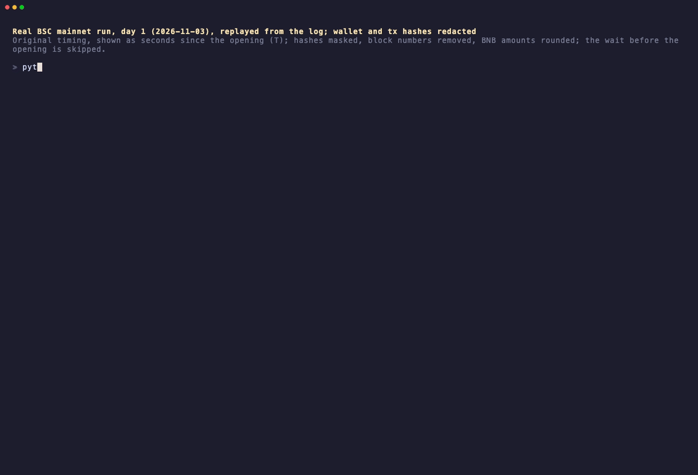
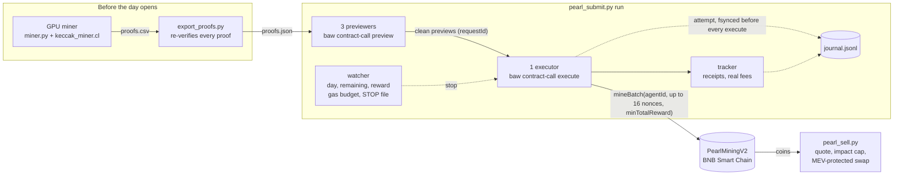

<div align="center">

# pearl-miner

**Mine PearlMiningV2 (珍珠币) proofs on your GPU, then claim them on BSC the second the daily window opens, through a Binance Agentic Wallet, without ever sending a proof twice or spending more gas than you allowed.**

[](LICENSE)


English · [繁體中文](README.zh-TW.md)



*Real BSC mainnet run, day 1 (2026-11-03), replayed from its log at original speed. Times are seconds since the opening; wallet and transaction hashes are masked, block numbers removed and BNB amounts rounded. From the opening to the cap being full took about a minute. ([MP4](demo/mainnet-replay.mp4))*

</div>

---

## One-command start

With proofs mined, run one line before the opening:

```bash
python3 pearl.py auto
```

It checks the wallet and the proofs and shows the plan (opening time, gas cap, sale share). After you type `yes` it runs on its own: it waits for the opening, submits, stops when the day's cap is full, then sells at most 80% of what this run's proofs can have earned (`--sell off` turns that off). It sells only after a normal finish. That cap is proofs mined × the reward read before the start, an upper bound, so of the coins you already held at most 80% of the gap between that bound and the real reward can be sold.

- Step by step: [docs/QUICKSTART.md](docs/QUICKSTART.md)
- With an AI agent (Claude Code, Codex, Grok Bot, ...): [docs/AGENTS-SETUP.md](docs/AGENTS-SETUP.md); the skill is [skills/pearl-miner/SKILL.md](skills/pearl-miner/SKILL.md)
- macOS, Windows, Linux and GPUs: [docs/PLATFORMS.md](docs/PLATFORMS.md)

---

## What it is

- **The token**: [PearlMiningV2](docs/CONTRACT.md) (token name and symbol: **珍珠币**) is a proof-of-work (PoW) token on BNB Smart Chain (BSC). Holders of a Binance **[Agent ID](#glossary)** use a graphics card (GPU) to compute valid hash solutions off-chain (called **[proofs](#glossary)**) and claim coins on-chain, packing up to **16 proofs** per transaction.
- **When it opens each day**: a **[daily cap](#glossary) of 20,000,000 coins** opens at the exact same second every day—**19:08:54 UTC+8 (11:08:54 UTC)**—and everyone who stockpiled proofs races for it at once.
- **What this tool does**: this repository is the complete automated toolchain that ran on BSC mainnet: GPU mining, proof verification and export, a free local **[fork simulation](#glossary)**, automated submission at the opening through a Binance **[Agentic Wallet](#glossary)** ([`baw`](#glossary) CLI), and **[MEV](#glossary)**-protected chunked selling.
- **Why you can mine in advance**: the mining seed (`seed`) is bound only to your **wallet address**—**not to a date, and proofs never expire**. Any proof you have not claimed on-chain yet can be used today, tomorrow, or days later (around day 4 the difficulty rises; see [the FAQ](#faq)). That means the daily race at 19:08:54 UTC+8 is not about who hashes fastest at that moment, but about **who already has proofs saved on disk and sends transactions to the chain when the window opens**.

**What does one wallet actually get?**

- On day 1 (2026-11-03) the whole 20,000,000-coin cap filled in about 59 s (day 0 took 70 min 36 s).
- With one wallet, this tool's first transaction was mined about 3 s after the opening; it sent 13 transactions, claimed 192 proofs and spent about 0.0006 BNB in gas.
- An Agentic Wallet can have only one transaction in flight per address (about one every 4 to 5 seconds), so that is the scale one wallet gets. Details: [Real-world numbers](#real-world-numbers-and-expected-returns).

---

## Who it suits and who it does not

### This suits you if:

- **You already hold a Binance Agent ID and an Agentic Wallet**: you want to put your Agent ID to use without ever storing a raw private key on your computer.
- **You do not write code, but can copy and paste commands into a terminal**: you do not need to edit any Python files—just follow the step-by-step commands below and check that the output matches.
- **You have an OpenCL-capable discrete GPU**: all numbers in this guide were measured on an RTX 4070 SUPER (about 6,900 proofs per hour); benchmark your own card to see its speed.
- **You have realistic expectations**: you know the 20M daily cap may fill in about a minute and just want a low-cost way to participate (about 0.0006 BNB on day 1, up to the gas budget you set).

### This does not suit you if:

- **You do not have a Binance Agent ID, or want to use a normal private-key wallet (EOA like MetaMask or Rabby)**: the contract requires a registered Agent ID on-chain, and this code is built specifically around `baw`'s `preview` / `execute` workflow and its one-transaction-at-a-time rule.
- **You expect large or guaranteed profits**: senders with their own private keys can keep several transactions in flight at once, whereas an Agentic Wallet cannot; the token trades in a single pool, **its price fell about 51% within 14 minutes** after the day-1 opening, and the price can drop to zero.
- **You do not want to touch a command line or install GPU drivers**: while everything is automated, you still run the scripts from a terminal.

---

## What to prepare (checklist, time, and cost)

Prepare the items below before you start. On an **RTX 4070 SUPER**, the hash rate is **about 2 GH/s**, averaging **about 1.9 stage-0 proofs per second**, or **about 6,900 proofs per hour** (Day 1 used only 192 proofs because the cap filled in 59 s; on a day like day 0 (70 min 36 s) one wallet could use over 10,000. The default gas budget allows roughly 900 transactions (~14,000 proofs), so mine for at least 1–2 hours; unused proofs never expire):

| Item | What it is for | Rough time | Rough cost |
|---|---|---|---|
| **1. Binance Agent ID & Agentic Wallet (`baw` CLI)** | Install the official `baw` CLI, sign in, pair with the Binance mobile app (status must be `CONNECTED`), and turn Developer Mode on. Official skills and docs: [binance/binance-skills-hub](https://github.com/binance/binance-skills-hub). | A few minutes (one-time setup) | Free (requires an existing Agent ID) |
| **2. A little BNB in that wallet** | Pays for BSC gas. The submitter keeps `--keep-bnb 0.005` BNB untouched and caps spending at `--budget-bnb 0.045` BNB (the day-1 wallet started with `~0.05 BNB`); the seller requires at least `--min-bnb 0.002` BNB. The real 13-tx run on day 1 cost **about 0.0006 BNB**. | A few minutes to transfer | ~0.0006 BNB measured on day 1; a single run can spend up to `--budget-bnb` (default 0.045 BNB) |
| **3. Python 3.9+** | The submitter (`pearl_submit.py`), the seller (`pearl_sell.py`), and `export_proofs.py` need **only the Python standard library** (`export_proofs.py` is faster with `pycryptodome`, which `miner/requirements.txt` installs). | Usually pre-installed | Free |
| **4. OpenCL GPU & miner packages** | For mining, an OpenCL GPU and `pip install -r miner/requirements.txt` (`numpy`, `pyopencl`, `pycryptodome`). About **6,900 proofs per hour** on an RTX 4070 SUPER. | Mine for at least 1–2 hours | GPU electricity only |
| **5. Foundry's `anvil` (optional, recommended)** | Runs the local fork simulation (step 5) so you can rehearse the entire opening against the real contract for free. Install from [getfoundry.sh](https://getfoundry.sh). | ~2 minutes per simulation | Free (0 BNB) |

---

## Glossary

Every term used in this guide, in plain language:

- **`proof`**: a valid hash puzzle solution computed by your GPU from your wallet's `seed` and a random `nonce` (see [Technical details](#technical-details-and-architecture) for the formula). Think of each proof as a single-use claim ticket tied to your wallet that never expires until you claim it.
- **`Agent ID`**: Binance's on-chain agent identity (an ERC-721 token in the BSC registry at `0x60B9262456dE011F7d15a54CdD8c48bAaa8B022F`). Apps often display it with a `.ai` suffix (like `yourhandle.ai`), but the raw handle stored on-chain has **no `.ai` suffix** and must be 3 to 20 lower-case letters (`a-z`) and digits (`0-9`).
- **`Agentic Wallet`**: Binance's keyless MPC (multi-party computation) wallet. No private key ever sits on your machine; transactions are simulated, screened for risk, and signed through Binance's backend.
- **`baw`**: the official command-line interface (CLI) for the Binance Agentic Wallet. These scripts drive `baw` to preview (`baw contract-call preview`), broadcast (`baw contract-call execute`), quote (`baw market-order quote`), and swap (`baw market-order swap`).
- **`gas`**: the fee paid in BNB to execute transactions on BNB Smart Chain (BSC). Claiming costs about 35.7k gas per proof (~570k gas, or ~0.000045–0.000055 BNB at 0.08–0.10 gwei, for a 16-proof batch). A transaction that reverts when the cap is already full costs about 0.000006 BNB.
- **`daily cap`**: the maximum number of coins the contract allows everyone combined to mine per day—**20,000,000 coins** (1/50 of the 1,000,000,000 max supply). The cap resets every day at **19:08:54 UTC+8 (11:08:54 UTC)**.
- **`journal`**: an append-only local file (`submit/journal.jsonl` for submitting, `submit/sell.jsonl` for selling) flushed to disk (`fsync`) before every action. Before sending any batch, the submitter writes an `attempt` record to lock those proofs; unless a receipt later proves that exact transaction reverted, or the wallet rejected it with `351716` before broadcast, those proofs are never sent again—even after a crash or reboot.
- **`fork simulation`**: a dress rehearsal using Foundry's `anvil` that clones BSC mainnet into local memory (`127.0.0.1:8547`) and pairs it with a fake `baw` to test the live day rollover and a simulated competitor without touching your real wallet or spending any BNB.
- **`MEV` (Maximal Extractable Value)**: bots on public blockchains that watch pending swaps and sandwich them to profit from your slippage. `pearl_sell.py` enables the wallet's MEV protection (passed internally to `baw` as `--mev true`; you do not pass this flag yourself), caps price impact per chunk against the current price (default 50%, `--max-impact 0.5`), never sells below half the price the sale started at (`--floor 0.5`), and caps slippage (default 3%, `--slippage 3`). The pool is very thin: on 2026-11-04 selling 23,958 coins took 42% impact, and a 2% cap (the default until v0.1.3) sold nothing while the price fell 88% within 4.5 minutes of the opening.

---

## Step by step

### Step 0: Clone the repository and set your wallet and handle

- **What it does**: downloads the code and sets your Agentic Wallet address (`PEARL_WALLET`) and raw Agent ID handle (`PEARL_HANDLE`) in your terminal session.
- **Command**:
  ```sh
  git clone https://gitlab.com/aa22396584/pearl-miner.git && cd pearl-miner
  export PEARL_WALLET=0xYourAgenticWalletAddress
  export PEARL_HANDLE=yourhandle            # the raw Agent ID handle: a-z and 0-9, WITHOUT ".ai"
  ```
  The program computes `agentId` and the mining `seed` for you automatically (see [Technical details](#technical-details-and-architecture) for the formulas). Every tool also accepts `--wallet` (and, where it needs one, `--handle`) instead of the environment. Both are checked before anything else happens, and **nothing is corrected for you**: the wallet must be `0x` and 40 hex digits (with a valid EIP-55 checksum if it mixes upper and lower case), and the handle must pass the registry's own rule (3 to 20 characters, `a-z` and `0-9` only, no `.ai`).
- **Common errors and how to handle them**:
  - `set the wallet address with --wallet or PEARL_WALLET (expected 0x followed by 40 hex digits; got ...)`: check that the address starts with lower-case `0x` followed by 40 hex characters.
  - `mixed case with a wrong EIP-55 checksum: a typo, or a different address`: a letter in the address was mistyped; copy the exact address from your wallet again.
  - `set the raw Agent ID handle with --handle or PEARL_HANDLE (pass the raw handle without the display '.ai' suffix; got 'yourhandle.ai')`: remove `.ai` and pass `yourhandle`.
  - `contains upper-case letters; registered handles are lower case` or `contains whitespace`: use lower-case letters and digits only, with no spaces.
- **How long it takes**: under 1 minute. **Tip**: run `check` (step 3) once before you spend GPU time—even without a proofs file, it reads the on-chain registry and confirms that the handle belongs to your wallet.

---

### Step 1: Mine proofs on your GPU (any time before the day opens; proofs never expire)

- **What it does**: runs a quick GPU kernel self-test (`--test`), re-checking at least 2,000 GPU hits (2,048 with the default settings) on the CPU; then mines stage-0 proofs continuously and appends CPU-verified hits to `miner/proofs.csv`.
- **Command**:
  ```sh
  pip install -r miner/requirements.txt            # first time only: installs numpy, pyopencl, pycryptodome
  python3 miner/miner.py --test                    # kernel self-test, re-checked on the CPU
  python3 miner/miner.py --out miner/proofs.csv    # runs until you: touch miner/STOP
  ```
- **What success looks like**:
  - For `--test`:
    ```text
    seed=0x... device=... prefix=0x... mask=0xfff per_launch=268435456
    WARNING: 65... hits in one launch, only 1024 kept
    WARNING: 65... hits in one launch, only 1024 kept
    TEST OK: 2048 GPU hits re-verified on CPU (mask 0xfff), expected ~131072
    ```
    The self-test uses a very low difficulty where each launch finds more hits than the 1,024-hit buffer holds, so printing two `WARNING … only 1024 kept` lines is normal.
  - For mining (prints a status line every 30 s, and stops cleanly when you run `touch miner/STOP`):
    ```text
    seed=0x... device=... prefix=0x... mask=0xfcffffff per_launch=268435456
    HH:MM:SS rate=2040.0MH/s proofs=57 hashes=...
    stopping: proofs=...
    ```
- **Common errors and how to handle them**:
  - `no OpenCL GPU found`: install your GPU driver and OpenCL runtime.
  - `give --wallet (or set PEARL_WALLET) or --seed`: export `PEARL_WALLET` or pass `--wallet 0x...`.
  - `--seed is not puzzleSeed(--wallet / PEARL_WALLET): proofs would be useless; give only one of them, or fix the one that is wrong`: pass only `--wallet` (or `PEARL_WALLET`) and let the miner derive the seed.
  - `KERNEL MISMATCH ctr=... hash=0x...`: the GPU produced a hash that failed CPU verification (e.g., unstable GPU overclock); the miner exits immediately without writing bad data.
  - **Note**: if you stopped the miner with `touch miner/STOP`, delete `rm miner/STOP` before starting it again.
- **How long it takes**: `--test` takes a few seconds. Mining on an RTX 4070 SUPER (~2 GH/s) produces about 1.9 proofs per second (~6,900 proofs per hour); Day 1 used only 192 proofs in the under-a-minute day-1 window because the cap filled in 59 s, whereas on a day like day 0 (70 min 36 s) one wallet could use over 10,000. The default gas budget allows roughly 900 transactions (~14,000 proofs), so mine for at least 1–2 hours; unused proofs never expire and can be used on later days.

---

### Step 2: Export and verify (`proofs.csv` → `proofs.json`)

- **What it does**: derives your wallet's `seed`, re-hashes every line of `miner/proofs.csv`, drops duplicates or invalid lines, and atomically writes `submit/proofs.json` for the submitter.
- **Command**:
  ```sh
  python3 submit/export_proofs.py miner/proofs.csv  # -> submit/proofs.json, every proof re-hashed
  ```
- **What success looks like**:
  ```text
  6900 verified unique proofs -> /…/pearl-miner/submit/proofs.json; rejected 0
  ```
- **Common errors and how to handle them**:
  - `set the wallet address with --wallet or PEARL_WALLET (...)`: set `PEARL_WALLET` or pass `--wallet`.
  - `rejected` count is greater than `0` (or all proofs are rejected): `PEARL_WALLET` does not match the wallet the CSV was mined for. Make sure both steps use the exact same wallet address.
- **How long it takes**: under 1 second for a few thousand proofs with `pycryptodome` installed; without `pycryptodome` it is much slower.

---

### Step 3: Check everything (read-only, no transaction sent)

- **What it does**: verifies on-chain that `handle` belongs to your wallet, checks `baw` session status (`CONNECTED`), settings, and `tx-lock`, compares your local clock with the chain, verifies that contract `owner()` is burned and not paused, prints your BNB balance and the next day's reward floor, and—once `submit/proofs.json` exists—checks a sample of proofs and simulates a claim call from your wallet via `eth_call`.
- **Command**:
  ```sh
  python3 submit/pearl_submit.py check                  # must end with: CHECK OK
  ```
- **What success looks like** (excerpt; real output prefixes every line with `HH:MM:SS.mmm`):
  ```text
  wallet 0x...; agentId = keccak256('yourhandle') = 0x...
  registry ownerOf(agentId) = 0x...; matches the wallet: True
  wallet session: CONNECTED (must be CONNECTED; otherwise re-pair with the Binance App)
  miningDay=1 dailyRemaining=0.00 currentReward=91.3086
  min reward per proof for day 2: 86.2400 (computed for the day)
  owner burned (nobody can pause/resume): True; paused now: False
  BNB balance 0.050000
  next day opens at unix 1793790534 = ... local, in ...s
  proof 0x00000000... used=False
  eth_call mineBatch(16) from wallet now: revert DailyLimitReached (DailyLimitReached before the day opens means identity and proofs pass)
  proofs file: 6900 unique proofs
  CHECK OK
  ```
  *(Note: if you run `check` before mining, it prints `no proofs file at .../submit/proofs.json yet: identity and chain checks only` and still ends with `CHECK OK` if your identity and wallet session are valid. Also, seeing `revert DailyLimitReached` before the window opens is **good**: the contract checks identity, unused status, and difficulty target before checking the daily cap!)*
- **Common errors and how to handle them**:
  - Ends with `CHECK HAS PROBLEMS`: check which line above printed `False`:
    - `registry ownerOf(agentId) = none (handle not registered)` or `matches the wallet: False`: your `PEARL_HANDLE` or `PEARL_WALLET` is wrong.
    - `wallet session: UNCONNECTED (must be CONNECTED; otherwise re-pair with the Binance App)`: re-pair `baw` with the Binance mobile app.
    - `baw not found on PATH`: install `baw` and ensure it is on your `PATH`.
    - `eth_call mineBatch(16) from wallet now: revert InvalidSolution`: your proofs do not meet the current difficulty stage (for example, stage 1 after 90M coins mined).
- **How long it takes**: a few seconds (read-only, costs 0 BNB).

---

### Step 4: Rehearse with the real wallet (three zero-value transfers to yourself; costs a little gas)

- **What it does** (we recommend completing step 5 first): previews and executes 3 (default `--parallel 3`) harmless `transfer(self, 0)` calls through `baw` back to back, verifying that your wallet session can preview and broadcast without requiring manual confirmation in the Binance mobile app (`requireConfirmation=False`), and observing how the wallet backend reacts to back-to-back sends (`--back-to-back`).
- **Command**:
  ```sh
  python3 submit/pearl_submit.py rehearse --back-to-back
  ```
- **What success looks like** (excerpt; real output prefixes every line with `HH:MM:SS.mmm`):
  ```text
  rehearsal: 3 x transfer(self, 0); previews concurrently, then executes back to back (each starts when the previous execute returns, without waiting for its receipt)
  #0 preview ...s ok  gasLimit=... requireConfirmation=False risks={"riskDetails": [], "addresses": {}, "riskBehaviors": []}
  ...
  RESULT nonces [...] distinct=True sent=.../3
  BACK-TO-BACK: proven accepted while pending=..., rejected 351716=..., inconclusive=... -> ...
  tx-lock after: ...
  ```
  *(Note: if the 2nd or 3rd execute is rejected with `351716` while the previous transaction is still pending, it prints `KEEP --settle DEFAULT: an execute was rejected while the previous tx was in progress`. That is expected and is why `run` waits up to `--settle 3.0` s between transactions.)*
- **Common errors and how to handle them**:
  - `not every preview was clean; executing none`: a preview failed, or `requireConfirmation=True`: the wallet wants you to confirm in the Binance app, which is what Binance's external-sign flow expects after a preview. This tool never confirms for you and sends nothing in that case. Binance does not endorse unattended sending like this; whether to change your wallet settings is your call — read the terms first (see Disclaimer).
- **How long it takes**: a few seconds for previews and executes, plus up to 90 s waiting for receipts (costs a tiny amount of gas for up to 3 zero-value transfers).

---

### Step 5: Simulate the whole run on a local fork (nothing is sent; no key needed)

- **What it does**: spins up a local `anvil` fork of BSC mainnet and the real contract in memory, simulates your wallet address on the local fork (`anvil`'s impersonation feature), uses a fake `baw` that only talks to `127.0.0.1`, sets the clock to 30 seconds before the next day's opening, runs a simulated competitor eating 4 proofs/s from a 400-proof cap, stops when the cap is full, and verifies 5 post-run assertions.
- **Command**:
  ```sh
  python3 submit/fork_rehearsal/run_fork.py --cap-proofs 400 --competitor-rate 4 --minutes 3
  # ... FORK REHEARSAL: PASS
  ```
  Add `--anonymize` before you share or record the output: it masks your address and the transaction hashes.
- **What success looks like**:
  ```text
  ==== FORK REHEARSAL RESULT ====
  exit=0 wall=...s fork_block=... journal=...
  txs broadcast=... ok=... reverted=... no_receipt=0
  proofs in ok txs=...; marked used on chain=...
  competitor ate ... proofs; chain now day=... remaining=... reward=...
  journal replay: blocked=... fees=... BNB reserved=0 open=[] used=0
  balance on fork: 0.049900 -> ... BNB (spent ...)
  stop reason: ['day ... budget full (remaining ... < reward ...)']
    [PASS] all ok-tx proofs used on chain
    [PASS] replay: nothing reserved or open
    [PASS] fees match spend
    [PASS] stopped for cap full
    [PASS] sent something
  FORK REHEARSAL: PASS
  ```
- **Common errors and how to handle them**:
  - `port 8547 is already in use (another anvil?): free it or pass --port`: stop any leftover `anvil` process or pass `--port` with another free port (1024 to 65535).
  - `no proofs file at .../submit/proofs.json: mine and export first, or pass --proofs`: complete steps 1 and 2 first.
  - `anvil did not answer in 30 s`: make sure Foundry's `anvil` is installed and your machine can reach the BSC RPC.
- **How long it takes**: about 2 minutes (including the 30-second countdown to the simulated opening; costs 0 BNB).

---

### Step 6: Run on mainnet (start it a few minutes before the opening; it waits on its own)

- **What it does**: starts in the background before the daily opening (**19:08:54 UTC+8 = 11:08:54 UTC**), verifies your wallet session is `CONNECTED`, locks `submit/journal.jsonl`, starts previewing 0.6 s before the boundary, and sends 16-proof batches back to back as soon as the chain shows the new day until the cap is full, the gas budget is reached, or you stop it.
- **Command**:
  ```sh
  nohup python3 submit/pearl_submit.py run > submit/run.log 2>&1 & echo $! > submit/run.pid
  tail -f submit/run.log                            # stop at any time: touch submit/STOP
  ```
  Without `--day` the run waits for the next opening. Day *N* opens at `1793617734 + N × 86400` (**11:08:54 UTC = 19:08:54 UTC+8** every day; day 0 was 2026-11-02); pass `--day N` to wait for a later day. A day whose run window (`--minutes`, default 90) is already over is refused. Keep the `echo $! > submit/run.pid`: it is how the seller knows the run has finished.

  The reward per proof falls with every claim, so the `minTotalReward` floor is computed for the target day: the lowest reward possible that day, minus 1% (**90.40 on day 1, 86.24 on day 2, 82.18 on day 3**; see [CONTRACT.md](docs/CONTRACT.md#reward-per-proof)). `--min-reward` (at least 1 coin) overrides it. From day 44 on the daily caps no longer bound the reward, so the computed floor is 0 and the run says so; pass `--min-reward` there.
- **What success looks like** (excerpt; real output prefixes every line with `HH:MM:SS.mmm`. This example comes from the anonymized `demo/day1-mainnet.log`: BNB amounts are rounded with `~` where the real output prints 6–7 decimals, and the `block N` that real receipt lines carry has been removed.):
  ```text
  wallet session CONNECTED
  owner burned (nobody can pause/resume): True
  run: 28063 usable proofs in 1754 batches (0 blocked); balance ~0.05 BNB, fees so far ~0, effective budget ~0.04, keep 0.005; previewers 3, executors 1; day 1 opens unix 1793704134 (851s from now)
  chain is on day 1: open (remaining 20000000, reward 95.6049)
  tx#1 broadcast 0x... (16 proofs, execute 2.10s)
  receipt 0x... status 1 mined 16 fee ~0.00005
  ...
  STOP: day 1 budget full (remaining 16.00 < reward 91.31)
  SUMMARY txs=13 proofs_mined=192 reverted=1 fees=~0.0006 BNB stop=day 1 budget full (remaining 16.00 < reward 91.31)
  ```
  *(Note: `day 1 budget full (remaining 16.00 < reward 91.31)` means the remaining daily cap for that day is less than one proof's reward—not that your BNB gas budget ran out.)*
- **Common errors and how to handle them**:
  - `baw wallet session is 'UNCONNECTED', not CONNECTED: re-pair with the Binance App, then start again`: re-pair `baw` with the Binance app and restart.
  - `another run already holds .../submit/journal.jsonl; refusing to start a second sender`: a submitter process is already running on that journal.
  - `--day N opened at unix ... and its 90-minute window is over; leave out --day to wait for the next opening`: omit `--day` so it targets the next opening automatically.
  - `STOP: STOP file`: a leftover `submit/STOP` file is present; remove it with `rm submit/STOP` before the next run.
  - `STOP: unexpected simulation failure: InvalidSolution`: difficulty rose (stage 1+ after 90M coins mined); filter your proofs first.
  - `STOP: unexpected simulation failure: RewardChanged`: the current reward is below `--min-reward`; omit `--min-reward` to use the automatic per-day floor.
- **How long it takes**: start it a few minutes before 19:08:54 UTC+8; once the window opens, day 1 finished in under a minute and spent about 0.0006 BNB in gas. **However, if the cap takes 70 minutes to fill like on day 0, the program keeps sending until the gas budget is used up, spending at most `--budget-bnb` (default 0.045 BNB); lower `--budget-bnb` if you want to spend less.**

---

### Step 7: Sell part of it (only after the run has finished)

- **What it does**: sells a fraction of your wallet's 珍珠币 for BNB in chunks through `baw market-order`. By default it sells **80%** (`--fraction 0.8`) and keeps 20%, in chunks of up to **100,000 coins** (`--chunk 100000`), checking each chunk against a 1,000-coin reference quote so a chunk's price impact never exceeds **50%** of the current price (`--max-impact 0.5`), and never selling below **half** the price the sale started at (`--floor 0.5`), so many chunks in a row cannot walk the price down without limit. A chunk over either limit is halved; if even the 20,000-coin minimum is over, `--mode now` stops and sells nothing more, with MEV protection (passed internally to `baw` as `--mev true`; you do not pass this flag yourself) and a **3%** slippage cap (`--slippage 3`). 50% sounds high, but the pool is that thin: on 2026-11-04 a 2% cap would have sold nothing while the price fell 88%.
- **Important guards**:
  1. The seller refuses while the process in `submit/run.pid` is alive, and also when that file is missing, so start the mining run as shown in step 6 (and **never create `run.pid` by hand**).
  2. It also refuses unless `PEARL_WALLET` is the wallet `baw` is signed in to (it asks `baw wallet address`): balances are read for the address you give, but swaps leave from the signed-in wallet.
  3. On day 1 the price fell about 51% within 14 minutes after the opening, so the price can drop quickly. If you do not want to take that price risk, pass `--mode now` to sell in chunks immediately; the default `--mode trail` is a chunked strategy designed from the pool's history. Either mode can lose money.
- **Command**:
  ```sh
  python3 submit/pearl_sell.py plan                 # read-only: balance, amount to sell, a reference quote
  python3 submit/pearl_sell.py run --dry-run        # real quotes, simulated fills, nothing sent
  python3 submit/pearl_sell.py run --mode now       # sells 80% now, in chunks of up to 100k coins
  ```
- **What success looks like**:
  - For `plan`:
    ```text
    HH:MM:SS wallet 0x... holds ... 珍珠币; selling 80% = ... coins in chunks of up to 100,000
    HH:MM:SS reference quote 1000 coins: {"success": true, ...}
    HH:MM:SS ≈ ... BNB per coin; whole sale ≈ ... BNB before impact
    HH:MM:SS mining run alive: False
    HH:MM:SS baw is signed in to 0x...; matches --wallet: True
    ```
  - For `run --mode now` (waits 30 s at the start to confirm your token balance has stopped changing, then quotes and swaps):
    ```text
    HH:MM:SS start balance ...; keeping ...; selling ...
    HH:MM:SS [now] quote ... coins -> ... BNB (impact ...%)
    HH:MM:SS order ... FINISHED: balance fell by ... coins for ... BNB, tx 0x...
    HH:MM:SS done: ... coins left above the kept ...
    HH:MM:SS end balance ... 珍珠币 (sold ...); BNB from finished orders ≈ ...
    ```
- **Common errors and how to handle them**:
  - `the mining run may still be alive (.../submit/run.pid missing or its process running): sell only after it has finished; never create run.pid by hand`: wait for step 6 to finish and make sure `submit/run.pid` was created by step 6.
  - `--wallet 0x... is not the wallet baw is signed in to (...): refusing to sell`: `PEARL_WALLET` does not match the wallet signed in to `baw`.
  - `less than 0.002 BNB for gas`: your wallet has less than `--min-bnb` (default 0.002 BNB).
  - `a 珍珠币 market order is PENDING (or the order list is unreadable): resolve it first`: wait for the pending order to finish (`baw market-order list --status PENDING`).
  - `swap without an orderId ...: stopping` or `order ... has no terminal status after 150s: stopping`: the seller stops immediately instead of resubmitting an order whose state is unknown; check `baw market-order list` and your balance first.
  - `STOP file: stopping`: `submit/STOP` is still present (for example, because you used it to stop the submitter); remove it first with `rm submit/STOP`.
- **How long it takes**: `plan` takes a few seconds; `run --mode now` waits 30 s to confirm a stable balance and completes a single chunk in under a minute (multiple chunks are spaced at least `--gap 60` seconds apart).

---

## Safety model

### In plain language: how the tools protect your wallet and gas

1. **Never sends a proof twice**: before every `execute`, the submitter writes and `fsync`s an `attempt` record for those 16 proofs to `journal.jsonl`. Unless a receipt later proves that exact transaction reverted, or the wallet backend rejected it before broadcast with `351716`, those proofs remain locked forever—even across power loss, crashes, and reboots.
2. **Stops instead of guessing**: if a preview reports any risk warning, asks for mobile app confirmation, returns an incomplete response, or fails simulation for an unexplained reason, the submitter stops cleanly instead of gambling your gas.
3. **Hard gas budget and keep reserve**: spending is capped at `min(--budget-bnb, start balance − --keep-bnb)` (defaults: `--budget-bnb 0.045` BNB, `--keep-bnb 0.005` BNB), counting confirmed fees, reserved fees for unknown outcomes, and 1.5× estimates for every transaction in flight.
4. **Splits batches near the cap**: because a 16-proof transaction reverts all-or-nothing if even one proof does not fit in the remaining daily cap, the submitter re-reads the chain near the 20M cap, subtracts its own in-flight proofs, and shrinks the batch to fit.
5. **Protected selling**: the seller checks that the mining run has finished and that `baw` is signed in to `--wallet`, quotes every chunk against a 1,000-coin reference quote to cap each chunk's price impact at 50% and never sells below half the starting price, enables MEV protection, measures progress strictly from on-chain token balances, and never resubmits an order in an unknown state.

### Technical summary table

| Guard | What it does |
|---|---|
| **Opening grace deadline** | At the opening the wallet's simulator can lag a block. A failed preview counts as "lag" only if our own `eth_call` succeeds **and** the wallet approves the same calldata on a re-preview within 30 s; the executor holds meanwhile. After the grace nothing is reclassified: the run stops. |
| **Stops on any preview risk** | Any risk item, risky address or risk behaviour in the preview, `requireConfirmation`, an incomplete answer, or a revert reason other than the expected ones stops the run. |
| **Gas budget with a keep reserve** | Spending stops at `min(--budget-bnb, start balance − --keep-bnb)`, counting real fees, reservations for unknown outcomes and 1.5× estimates for everything in flight. |
| **One executor** | Only one thread ever calls `execute`, and only after a gate check made under the same lock as `stop()`. `--executors` other than 1 is refused. |
| **Journal-based restart safety** | An `attempt` record is fsynced before every execute. Its proofs stay blocked until a receipt proves that transaction reverted, or the wallet rejected it with `351716` before broadcast (nothing was sent). A restart replays the journal; a file lock refuses a second sender. |
| **STOP file** | `touch submit/STOP` (or Ctrl-C / SIGTERM, or the deadline) stops the run between steps. The seller honours the same file. Delete it before the next start. |
| **Near-cap splitting** | Before each send close to the cap the room is read again, minus our own in-flight proofs; a batch that would revert whole is split to fit. |
| **Input checks** | The wallet must be `0x` + 40 hex digits, with a valid EIP-55 checksum when it is mixed case; the handle must pass the registry's `isValidHandle` (`a-z0-9`, 3 to 20 characters); `--seed` and `--wallet` given together must agree; `--min-reward` is at least 1 coin. `check` confirms on chain that the handle belongs to the wallet, and the seller refuses a `--wallet` that is not the wallet `baw` is signed in to. |
| **MEV-protected sells with an impact cap** | Every chunk is quoted against a small reference quote; above 50% impact, or below half the sale's starting price, it is halved (in `--mode now`, if even the minimum chunk is, the sale stops and sells nothing more). Swaps use the wallet's MEV protection and a slippage cap; an order in an unknown state is never resubmitted. |

---

## Real-world numbers and expected returns

These are honest numbers from mainnet, not a promise.

| | Day 0 (2026-11-02) | Day 1 (2026-11-03) |
|---|---|---|
| Time from the opening until the 20M cap was full (block of the last successful claim) | 70 min 36 s | **about 59 s** |

What this tool did with **one wallet** on day 1 (the replay at the top of this page):

- **13 transactions**, **192 proofs mined** (about 91–96 coins each; the reward decreases as claims accumulate across the network), the first one mined **about 3 s** after the opening;
- **1 revert**: the last transaction, sent as the cap filled (it cost about 0.000006 BNB);
- **about 0.0006 BNB** gas in total;
- one transaction every 4 to 5 seconds, the limit of one in-flight transaction per address.

### What that means for your returns

- **Competition is intense** and was much faster on day 1 (about 59 s) than on day 0 (70 min 36 s). Senders with their own private keys (EOAs) can keep several transactions in flight at once; an Agentic Wallet cannot. Expect a small share of each day.
- **Profit is small and not guaranteed.** The coin trades in a single PancakeSwap Infinity (v4) pool (0.3726% fee); selling moves the price, and the price can fall to nothing. On day 1 the price fell about 51% within 14 minutes after the opening; see step 7 for when to sell.
- **Gas is cheap and capped** (about 35.7k gas per proof; ~0.0006 BNB for the whole 13-transaction day-1 run). On a day where the cap takes 70 minutes to fill, like day 0, a run can spend up to `--budget-bnb` (default 0.045 BNB). The other costs are your GPU's electricity and your time.

---

## FAQ

**I do not write code. Can I still use this?**
Yes. You do not need to edit any code—just copy and paste the commands in the step-by-step guide above. Run the read-only `check` (step 3) and the free local fork simulation `run_fork.py` (step 5) first so you can see `CHECK OK` and `FORK REHEARSAL: PASS` before risking a single wei on mainnet.

**How many proofs do I need to mine for one day?**
Because an Agentic Wallet can only have one transaction in flight at a time (one 16-proof batch every 4 to 5 seconds), in the under-a-minute day-1 window one wallet sent 13 transactions and used only **192 proofs** because the cap filled in 59 s; on a day like day 0 (70 min 36 s) one wallet could use over 10,000. The default gas budget allows roughly 900 transactions (~14,000 proofs), so at RTX 4070 SUPER speed (~1.9 proofs/s, or ~6,900 proofs/hour), mine for at least 1–2 hours; unused proofs never expire and can be used on later days.

**Do I need a private key?**
No. The Binance Agentic Wallet is an MPC wallet; the tools call its CLI (`baw`). The fork simulation simulates your wallet address on a local fork (`anvil`'s impersonation feature), which needs no key either.

**Can I use a normal wallet (EOA) instead?**
Not with this code: it is built around `baw`'s preview / execute flow and its one-transaction-at-a-time rule.

**Why only one executor?**
The wallet backend rejects a second `execute` while one is in progress (`351716`). Parallel executors only add rejected calls.

**Why 16 proofs per transaction?**
It is the contract's `MAX_BATCH`. A batch is all or nothing, which is why the submitter splits batches near the cap.

**What does `--handle` expect?**
The raw handle, exactly as the registry stores it, without the display `.ai` suffix: 3 to 20 characters, lower-case letters and digits only (the registry's `isValidHandle`). The tools refuse anything else (upper case, spaces, `.ai`) instead of guessing. `check` reads the registry and says whether the handle belongs to your wallet; if it reports `InvalidIdentity` or no match, the handle or the wallet is wrong.

**When should I start `pearl_submit.py run` each day?**
The daily cap opens at **19:08:54 UTC+8 (11:08:54 UTC)**. Start the command in step 6 a few minutes before the opening; it waits on its own and starts previewing 0.6 s before the boundary.

**My proofs are from an earlier day. Are they still good?**
Yes, until a proof is used. But after 90M coins have been mined (around day 4) the difficulty rises by 1.5× and about a third of stage-0 proofs no longer qualify; the submitter then stops on `InvalidSolution`. Filter your proofs first (see [CONTRACT.md](docs/CONTRACT.md#difficulty-stages)).

**The run stopped with `RewardChanged`.**
The per-proof floor is above the current reward. That should not happen with the floor computed for the target day; if you passed `--day` or `--min-reward`, check them.

**What if the machine reboots mid-run?**
Start the same command again with the same `--journal`. Proofs that may have been sent stay blocked; pending transactions are looked up and their fees counted.

**What is the difference between `--mode now` and the default `--mode trail` when selling?**
`--mode now` starts selling in chunks right after the run finishes and the initial 30-second balance check passes (with at least 60 s between chunks, `--gap 60`). The default `--mode trail` polls a reference quote every 30 s (`--poll 30`) and waits either for a 7% pullback (`--pullback 0.07`) from the running high or for a linear schedule between 20 and 120 minutes (`--warmup 20`, `--deadline 120`). Either mode can lose money.

**Is the fork simulation really harmless?**
Yes. The fake `baw` refuses any RPC other than `127.0.0.1`, the submitter's RPC list is pointed at the fork, and the script refuses to start if its local port (8547, or `--port`) is already taken by another node.

**Why does the replay show `T+2.53s` instead of the time, and no block numbers?**
`tools/replay_log.py --anonymize` hides the values in a log: hashes and addresses, block numbers, exact BNB amounts, the handle, the clock time and the time zone. It does not hide the run itself. The opening second is public, so the T+ times, the number of transactions and their order can still be matched against the chain by someone who looks; the day-1 replay above can be traced to its wallet that way. Do not publish a log if your wallet must stay unlinkable.

---

## Technical details and architecture

### Toolchain overview

| Stage | Tool | Description |
|---|---|---|
| Mine | `miner/miner.py` + `keccak_miner.cl` | OpenCL Keccak miner, every GPU hit re-checked on the CPU |
| Verify | `submit/export_proofs.py` | re-hashes every proof for your wallet, writes `proofs.json` |
| Submit | `submit/pearl_submit.py` | `check` / `rehearse` / `run` through the `baw` CLI |
| Simulate | `submit/fork_rehearsal/run_fork.py` | the whole run against the real contract on a local anvil fork |
| Sell | `submit/pearl_sell.py` | quoted, impact-capped, MEV-protected sales in chunks |
| Replay | `tools/replay_log.py` | replays a run log with its original timing, anonymized |

### Key technical features

- **Contract formulas and fast GPU mining**: on-chain identity `agentId = uint256(keccak256(handle))`, mining seed `seed = keccak256(abi.encode(publicChallenge, wallet))`, valid solution `proof = keccak256(seed ‖ nonce)` (top 30 bits zero at stage 0), claimed via `mineBatch(agentId, nonces, minTotalReward)` (up to 16 proofs per transaction). Hand-unrolled Keccak-f[1600] in OpenCL, about 2 GH/s (≈ 1.9 stage-0 proofs per second, about 6,900 per hour) on an RTX 4070 SUPER. Proofs are bound to your wallet, not to a day, so you mine ahead of time.
- **Starts on its own at the opening**: previewers begin 0.6 s before the boundary; on mainnet the first transaction was mined about 3 s after the opening.
- **Pipelined**: three previewers keep simulated, risk-screened transactions ready, one executor sends them back to back, a tracker collects receipts, a watcher reads day, remaining cap and reward from a single block via Multicall3 `aggregate3`.
- **Never sends a proof twice**: an fsynced journal entry precedes every `execute`; a restart replays the journal.
- **Stops instead of guessing**: any preview risk warning, any unexplained simulation failure, the gas budget, the `STOP` file or the deadline ends the run cleanly.
- **Splits batches near the cap** instead of letting a whole 16-proof transaction revert.
- **No private key anywhere**: the Binance Agentic Wallet is MPC; the tools only drive its CLI.
- **Proven before mainnet**: six offline test suites (**89** checks for the submitter, **118** for the seller, **38** for the log redaction, **144** for the one-command `pearl.py`, **17** for the miner's launch sizing, **38** for `pearl.py` end to end with real signals), run on macOS, Linux and Windows ([PLATFORMS.md](docs/PLATFORMS.md)), and a full fork simulation against the real contract with a live opening and a competitor eating the cap.
- **Standard library only** for the submitter and the seller: copy `pearl_submit.py` (and `pearl_sell.py`, which imports its address checks) to the machine with the wallet session.

### Pipeline diagram



The wallet backend accepts **one in-flight transaction per address** (anything else is rejected with `351716`), so the speed limit is one executor sending back to back. Everything else is built to keep that executor busy and safe.
Details: [docs/ARCHITECTURE.md](docs/ARCHITECTURE.md) · contract facts: [docs/CONTRACT.md](docs/CONTRACT.md).

### More demos

**Fork simulation**: the real contract on a local anvil fork, a fake `baw` that only talks to 127.0.0.1, the next day opening live, a competitor eating the cap, and the five end checks. Recorded with `--anonymize` (times since the simulated opening, hashes and addresses masked) and a sample file of 400 proofs. ([MP4](demo/simulation.mp4))


**Offline test suites**: the submitter against a fake chain and a fake `baw` (89 checks); the seller against a pool model calibrated on the real pool (118 checks); the log redaction rules (38 checks); `pearl.py` with fake child scripts (144 checks); the miner's launch sizing (17 checks); and `pearl.py` with the real submitter and seller on a fake chain and market, stopped by STOP and real Ctrl-C (38 checks). The list and how to run them: [docs/QUICKSTART.md](docs/QUICKSTART.md#check-the-code-yourself-optional). ([MP4](demo/tests.mp4))


Render them yourself with [vhs](https://github.com/charmbracelet/vhs): `vhs demo/tests.tape`.

### Repository layout

```text
pearl.py               one command for a mining day: check, plan, yes, submit, sell
AGENTS.md              rules for AI agents (CLAUDE.md and GEMINI.md import it)
skills/pearl-miner/    the pearl-miner skill (SKILL.md, one self-contained file)
miner/                 OpenCL miner (miner.py, keccak_miner.cl, requirements.txt, test_autotune.py: 17 checks)
submit/
  pearl_submit.py      the submitter: check / rehearse / run
  export_proofs.py     proofs.csv -> verified proofs.json
  pearl_sell.py        the seller: plan / run [--dry-run]
  test_submit.py       offline tests for the submitter (89 checks)
  test_sell.py         offline tests for the seller (118 checks)
  fork_rehearsal/      anvil fork simulation + fake baw (127.0.0.1 only)
tools/replay_log.py    replay a run log with its timing, anonymized
tools/test_replay_log.py  offline tests for the redaction (38 checks)
tools/test_pearl_autopilot.py  offline tests for pearl.py (144 checks)
tools/test_pearl_e2e.py  pearl.py end to end: real submitter and seller, real signals (38 checks)
demo/                  vhs tapes, GIF / MP4 renders, the anonymized day-1 log
docs/                  QUICKSTART, AGENTS-SETUP, PLATFORMS, CONTRACT.md, ARCHITECTURE.md
```

---

## Disclaimer

This is not financial advice. Mining and trading this token can lose money: gas, electricity and the coin's price are all on you, and there is a single market for the coin. The contract, the token or its liquidity can fail, be abandoned or be pulled (a rug pull), and the coin can become worthless overnight. Mining and selling tokens can be taxable or regulated where you live; checking that is your job. Driving a wallet with scripts may break the wallet provider's terms of service and get the account limited; Binance's external-sign flow expects you to confirm in the Binance app after a preview, and this tool never confirms for you and sends nothing in that case; Binance does not endorse unattended sending like this, and whether to change your wallet settings is your call — read the terms first. The software is provided "as is", without warranty of any kind; use it at your own risk and only with funds you can afford to lose. This project is **not affiliated with** Binance, PancakeSwap, BNB Chain or the token's team. "Binance", "PancakeSwap" and "BNB" are trademarks of their owners.

## License

[GNU AGPL-3.0-or-later](LICENSE) © 2026 Akari Sora

In short: you may use, study, modify and share it. If you distribute a modified version, or run one as a network service for others, you must publish your source under the same license.

Canonical repo, issues and releases: https://gitlab.com/aa22396584/pearl-miner
