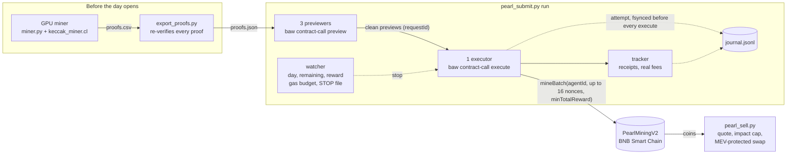

<div align="center">

# pearl-miner

**Mine PearlMiningV2 (珍珠币) proofs on your GPU, then claim them on BSC the second the daily window opens, through a Binance Agentic Wallet, without ever sending a proof twice or spending more gas than you allowed.**

[](LICENSE)


English · [繁體中文](README.zh-TW.md)


*Real BSC mainnet run, day 1 (2026-11-03), replayed from its log at original speed. Times are seconds since the
opening; wallet and transaction hashes are masked, block numbers removed and BNB amounts rounded. From the opening to
the cap being full took about a minute. ([MP4](demo/mainnet-replay.mp4))*

</div>

---

## What it is

[PearlMiningV2](docs/CONTRACT.md) is a proof-of-work token on BNB Smart Chain. Holders of a Binance **Agent ID** mine
proofs off-chain (`keccak256(seed ‖ nonce)` with the top 30 bits zero) and claim them with
`mineBatch(agentId, nonces, minTotalReward)`, up to 16 per transaction. A **daily cap of 20,000,000 coins** opens
at the same second every day, and everyone who stockpiled proofs races for it.

This repository is the complete toolchain that ran on mainnet:

| Stage | Tool | |
|---|---|---|
| Mine | `miner/miner.py` + `keccak_miner.cl` | OpenCL Keccak miner, every GPU hit re-checked on the CPU |
| Verify | `submit/export_proofs.py` | re-hashes every proof for your wallet, writes `proofs.json` |
| Submit | `submit/pearl_submit.py` | `check` / `rehearse` / `run` through the `baw` CLI |
| Simulate | `submit/fork_rehearsal/run_fork.py` | the whole run against the real contract on a local anvil fork |
| Sell | `submit/pearl_sell.py` | quoted, impact-capped, MEV-protected sales in chunks |
| Replay | `tools/replay_log.py` | replays a run log with its original timing, anonymized |

## Features

- **Fast GPU mining**: hand-unrolled Keccak-f[1600] in OpenCL, about 2 GH/s (≈ 1.9 stage-0 proofs per second) on an
  RTX 4070 SUPER. Proofs are bound to your wallet, not to a day, so you mine ahead of time.
- **Starts on its own at the opening**: previewers begin 0.6 s before the boundary; on mainnet the first
  transaction was broadcast 2.5 s after the chain showed the new day.
- **Pipelined**: three previewers keep simulated, risk-screened transactions ready, one executor sends them back to
  back, a tracker collects receipts, a watcher reads day, remaining cap and reward from a single block.
- **Never sends a proof twice**: an fsynced journal entry precedes every `execute`; a restart replays the journal.
- **Stops instead of guessing**: any preview risk warning, any unexplained simulation failure, the gas budget, the
  `STOP` file or the deadline ends the run cleanly.
- **Splits batches near the cap** instead of letting a whole 16-proof transaction revert.
- **No private key anywhere**: the Binance Agentic Wallet is MPC; the tools only drive its CLI.
- **Proven before mainnet**: offline test suites (52 checks for the submitter, 67 for the seller, 38
  for the log redaction) and a full fork simulation against the real contract with a live opening and a competitor
  eating the cap.
- **Standard library only** for the submitter and the seller: copy `pearl_submit.py` (and `pearl_sell.py`, which
  imports its address checks) to the machine with the wallet session.

## How it works



The wallet backend accepts **one in-flight transaction per address** (anything else is rejected with `351716`), so
the speed limit is one executor sending back to back. Everything else is built to keep that executor busy and safe.
Details: [docs/ARCHITECTURE.md](docs/ARCHITECTURE.md) · contract facts: [docs/CONTRACT.md](docs/CONTRACT.md).

## Quick start

You need:

- a Binance **Agent ID** and its **Agentic Wallet**, with the `baw` CLI installed, signed in and Developer Mode on
  (official skills and docs: [binance/binance-skills-hub](https://github.com/binance/binance-skills-hub));
- a little BNB in that wallet for gas;
- Python 3.9+ (the submitter, the seller and `export_proofs.py` need nothing else; `export_proofs.py` is faster
  with pycryptodome, which `miner/requirements.txt` installs);
- for mining, an OpenCL GPU and `pip install -r miner/requirements.txt`;
- for the fork simulation, [Foundry](https://getfoundry.sh)'s `anvil`.

```sh
git clone https://gitlab.com/aa22396584/pearl-miner.git && cd pearl-miner
export PEARL_WALLET=0xYourAgenticWalletAddress
export PEARL_HANDLE=yourhandle            # the raw Agent ID handle: a-z and 0-9, WITHOUT ".ai"
```

The agentId is `uint256(keccak256(handle))` and the mining seed is `keccak256(abi.encode(publicChallenge, wallet))`;
both are computed for you. Every tool also accepts `--wallet` (and, where it needs one, `--handle`) instead of
the environment. Both are checked before anything else happens, and nothing is corrected for you: the wallet must
be `0x` and 40 hex digits (with a valid EIP-55 checksum if it mixes upper and lower case), and the handle must pass
the registry's own rule (3 to 20 characters, `a-z` and `0-9` only, no `.ai`).

Run `check` (step 3) once before you spend GPU time: without a proofs file it still reads the registry and confirms
that the handle belongs to your wallet.

**1. Mine** (any time before the day opens; proofs never expire)

```sh
python3 miner/miner.py --test                    # kernel self-test, re-checked on the CPU
python3 miner/miner.py --out miner/proofs.csv    # runs until you: touch miner/STOP
```

**2. Export and verify**

```sh
python3 submit/export_proofs.py miner/proofs.csv  # -> submit/proofs.json, every proof re-hashed
```

**3. Check** (read-only, no transaction)

```sh
python3 submit/pearl_submit.py check                  # must end with: CHECK OK
```

**4. Rehearse with the real wallet** (three zero-value transfers to yourself; costs a little gas)

```sh
python3 submit/pearl_submit.py rehearse --back-to-back
```

**5. Simulate the whole run on a local fork** (nothing is sent; no key needed)

```sh
python3 submit/fork_rehearsal/run_fork.py --cap-proofs 400 --competitor-rate 4 --minutes 3
# ... FORK REHEARSAL: PASS
```

Add `--anonymize` before you share or record the output: it masks your address and the transaction hashes.

**6. Run** (start it a few minutes before the opening; it waits on its own)

```sh
nohup python3 submit/pearl_submit.py run > submit/run.log 2>&1 & echo $! > submit/run.pid
tail -f submit/run.log                            # stop at any time: touch submit/STOP
```

Without `--day` the run waits for the next opening. Day *N* opens at `1793617734 + N × 86400` (11:08:54 UTC every
day; day 0 was 2026-11-02); pass `--day N` to wait for a later day. A day whose run window (`--minutes`, default 90)
is already over is refused. Keep the `echo $! > submit/run.pid`: it is how the seller knows the run has finished.

The reward per proof falls with every claim, so the `minTotalReward` floor is computed for the target day: the lowest
reward possible that day, minus 1% (90.40 on day 1, 86.24 on day 2, 82.18 on day 3; see
[CONTRACT.md](docs/CONTRACT.md#reward-per-proof)). `--min-reward` (at least 1 coin) overrides it. From day 44 on the
daily caps no longer bound the reward, so the computed floor is 0 and the run says so; pass `--min-reward` there.

**7. Sell part of it** (only after the run has finished: the seller refuses while the process in `submit/run.pid` is
alive, and also when that file is missing, so start the run as in step 6)

It also refuses unless `PEARL_WALLET` is the wallet `baw` is signed in to (it asks `baw wallet address`): balances
are read for the address you give, but swaps leave from the signed-in wallet.

On day 1 the price fell about 51% in the 14 minutes after the opening, so if you intend to sell, sell as soon as
your run has finished (`--mode now`) rather than waiting.

```sh
python3 submit/pearl_sell.py plan                 # read-only: balance, amount to sell, a reference quote
python3 submit/pearl_sell.py run --dry-run        # real quotes, simulated fills, nothing sent
python3 submit/pearl_sell.py run --mode now       # sells 80% now, in chunks of up to 100k coins
```

## Safety model

| Guard | What it does |
|---|---|
| **Opening grace deadline** | At the opening the wallet's simulator can lag a block. A failed preview counts as "lag" only if our own `eth_call` succeeds **and** the wallet approves the same calldata on a re-preview within 30 s; the executor holds meanwhile. After the grace nothing is reclassified: the run stops. |
| **Stops on any preview risk** | Any risk item, risky address or risk behaviour in the preview, `requireConfirmation`, an incomplete answer, or a revert reason other than the expected ones stops the run. |
| **Gas budget with a keep reserve** | Spending stops at `min(--budget-bnb, start balance − --keep-bnb)`, counting real fees, reservations for unknown outcomes and 1.5× estimates for everything in flight. |
| **One executor** | Only one thread ever calls `execute`, and only after a gate check made under the same lock as `stop()`. `--executors` other than 1 is refused. |
| **Journal-based restart safety** | An `attempt` record is fsynced before every execute. Its proofs stay blocked until a receipt proves that transaction reverted. A restart replays the journal; a file lock refuses a second sender. |
| **STOP file** | `touch submit/STOP` (or Ctrl-C / SIGTERM, or the deadline) stops the run between steps. The seller honours the same file. Delete it before the next start. |
| **Near-cap splitting** | Before each send close to the cap the room is read again, minus our own in-flight proofs; a batch that would revert whole is split to fit. |
| **Input checks** | The wallet must be `0x` + 40 hex digits, with a valid EIP-55 checksum when it is mixed case; the handle must pass the registry's `isValidHandle` (`a-z0-9`, 3 to 20 characters); `--seed` and `--wallet` given together must agree; `--min-reward` is at least 1 coin. `check` confirms on chain that the handle belongs to the wallet, and the seller refuses a `--wallet` that is not the wallet `baw` is signed in to. |
| **MEV-protected sells with an impact cap** | Every chunk is quoted against a small reference quote; above 2% impact it is halved or postponed. Swaps use the wallet's MEV protection and a slippage cap; an order in an unknown state is never resubmitted. |

## Real-world numbers

These are honest numbers from mainnet, not a promise.

| | Day 0 (2026-11-02) | Day 1 (2026-11-03) |
|---|---|---|
| Time from the opening until the 20M cap was full | 70 min 36 s | **64 s** |

What this tool did with **one wallet** on day 1 (the replay above):

- 13 transactions, **192 proofs mined** (about 95 coins each), the first one broadcast 2.5 s after the chain
  showed the new day;
- 1 revert: the last transaction, sent as the cap filled (it cost about 0.000006 BNB);
- **about 0.0006 BNB** gas in total;
- one transaction every 4 to 5 seconds, the limit of one in-flight transaction per address.

What that means:

- **Competition is intense** and was faster on day 1 than on day 0. Senders with their own keys can keep several
  transactions in flight; an Agentic Wallet cannot. Expect a small share of each day.
- **Profit is small and not guaranteed.** The coin traded in a single PancakeSwap Infinity (v4) pool
  (0.3726% fee); selling moves the price, and the price can fall to nothing. On day 1 it fell about 51% in the
  14 minutes after the opening: if you sell, sell right after mining.
- Gas is cheap (about 35.7k gas per proof), so the main costs are your GPU's electricity and your time.

## More demos

**Fork simulation**: the real contract on a local anvil fork, a fake `baw` that only talks to 127.0.0.1, the next
day opening live, a competitor eating the cap, and the five end checks. Recorded with `--anonymize` (times since the
simulated opening, hashes and addresses masked) and a sample file of 400 proofs. ([MP4](demo/simulation.mp4))


**Offline test suites**: the submitter against a fake chain and a fake `baw`; the seller against a pool model
calibrated on the real pool. ([MP4](demo/tests.mp4))


Render them yourself with [vhs](https://github.com/charmbracelet/vhs): `vhs demo/tests.tape`.

## Repository layout

```text
miner/                 OpenCL miner (miner.py, keccak_miner.cl, requirements.txt)
submit/
  pearl_submit.py      the submitter: check / rehearse / run
  export_proofs.py     proofs.csv -> verified proofs.json
  pearl_sell.py        the seller: plan / run [--dry-run]
  test_submit.py       offline tests for the submitter
  test_sell.py         offline tests for the seller
  fork_rehearsal/      anvil fork simulation + fake baw (127.0.0.1 only)
tools/replay_log.py    replay a run log with its timing, anonymized
tools/test_replay_log.py  offline tests for the redaction
demo/                  vhs tapes, GIF / MP4 renders, the anonymized day-1 log
docs/                  CONTRACT.md, ARCHITECTURE.md
```

## FAQ

**Do I need a private key?**
No. The Binance Agentic Wallet is an MPC wallet; the tools call its CLI (`baw`). The fork simulation impersonates
your address on a local fork, which needs no key either.

**Can I use a normal wallet (EOA) instead?**
Not with this code: it is built around `baw`'s preview / execute flow and its one-transaction-at-a-time rule.

**Why only one executor?**
The wallet backend rejects a second `execute` while one is in progress (`351716`). Parallel executors only add
rejected calls.

**Why 16 proofs per transaction?**
It is the contract's `MAX_BATCH`. A batch is all or nothing, which is why the submitter splits batches near the cap.

**What does `--handle` expect?**
The raw handle, exactly as the registry stores it, without the display `.ai` suffix: 3 to 20 characters, lower-case
letters and digits only (the registry's `isValidHandle`). The tools refuse anything else (upper case, spaces, `.ai`)
instead of guessing. `check` reads the registry and says whether the handle belongs to your wallet; if it reports
`InvalidIdentity` or no match, the handle or the wallet is wrong.

**My proofs are from an earlier day. Are they still good?**
Yes, until a proof is used. But after 90M coins have been mined (around day 4) the difficulty rises by 1.5× and
about a third of stage-0 proofs no longer qualify; the submitter then stops on `InvalidSolution`. Filter your proofs
first (see [CONTRACT.md](docs/CONTRACT.md#difficulty-stages)).

**The run stopped with `RewardChanged`.**
The per-proof floor is above the current reward. That should not happen with the floor computed for the target day;
if you passed `--day` or `--min-reward`, check them.

**What if the machine reboots mid-run?**
Start the same command again with the same `--journal`. Proofs that may have been sent stay blocked; pending
transactions are looked up and their fees counted.

**Is the fork simulation really harmless?**
Yes. The fake `baw` refuses any RPC other than `127.0.0.1`, the submitter's RPC list is pointed at the fork, and
the script refuses to start if its local port (8547, or `--port`) is already taken by another node.

**Why does the replay show `T+2.53s` instead of the time, and no block numbers?**
`tools/replay_log.py --anonymize` hides the values in a log: hashes and addresses, block numbers, exact BNB amounts,
the handle, the clock time and the time zone. It does not hide the run itself. The opening second is public, so the
T+ times, the number of transactions and their order can still be matched against the chain by someone who looks;
the day-1 replay above can be traced to its wallet that way. Do not publish a log if your wallet must stay
unlinkable.

## Disclaimer

This is not financial advice. Mining and trading this token can lose money: gas, electricity and the coin's price
are all on you, and there is a single market for the coin. The contract, the token or its liquidity can fail, be
abandoned or be pulled (a rug pull), and the coin can become worthless overnight. Mining and selling tokens can be
taxable or regulated where you live; checking that is your job. Driving a wallet with scripts may break the wallet
provider's terms of service and get the account limited; read them first. The software is provided "as is", without
warranty of any kind; use it at your own risk and only with funds you can afford to lose. This project is **not affiliated with** Binance,
PancakeSwap, BNB Chain or the token's team. "Binance", "PancakeSwap" and "BNB" are trademarks of their owners.

## License

[MIT](LICENSE) © 2026 Akari Sora

Canonical repo, issues and releases: https://gitlab.com/aa22396584/pearl-miner
