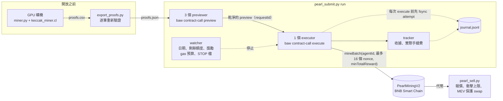

<div align="center">

# pearl-miner

**用 GPU 預先挖好 PearlMiningV2（珍珠币）的 proof，在每日額度開放的那一秒，透過幣安 Agentic Wallet 送上 BSC；同一個 proof 絕不重送，gas 絕不超過你設的上限。**

[](LICENSE)


[English](README.md) · 繁體中文


*BSC 主網第 1 天（2026-11-03）的真實送單，依原始紀錄以原速重播。時間以「開放後幾秒」顯示；錢包與交易雜湊已遮蔽，
區塊高度已移除，BNB 金額已四捨五入。從開放到當日額度用完約一分鐘。（[MP4](demo/mainnet-replay.mp4)）*

</div>

---

## 這是什麼

[PearlMiningV2](docs/CONTRACT.md) 是 BNB Smart Chain 上的工作量證明代幣。持有幣安 **Agent ID** 的人在鏈下挖
proof（`keccak256(seed ‖ nonce)`，前 30 bits 為 0），再用 `mineBatch(agentId, nonces, minTotalReward)` 上鏈領取，
每筆最多 16 個。**每日額度 2,000 萬枚**，每天同一秒開放，所有囤了 proof 的人同時搶。

這個 repo 就是實際在主網跑過的整套工具：

| 階段 | 工具 | |
|---|---|---|
| 挖礦 | `miner/miner.py` + `keccak_miner.cl` | OpenCL Keccak 礦機，GPU 找到的每一筆都在 CPU 上重算確認 |
| 驗證 | `submit/export_proofs.py` | 依你的錢包逐筆重算 proof，輸出 `proofs.json` |
| 送單 | `submit/pearl_submit.py` | 透過 `baw` CLI 執行 `check` / `rehearse` / `run` |
| 模擬 | `submit/fork_rehearsal/run_fork.py` | 在本機 anvil 分叉上，對真合約跑完整送單流程 |
| 賣出 | `submit/pearl_sell.py` | 先報價、限制價格衝擊、MEV 保護，分批賣出 |
| 重播 | `tools/replay_log.py` | 依原始節奏重播送單紀錄，並去除可識別資訊 |

## 功能

- **GPU 高速挖礦**：OpenCL 手動展開的 Keccak-f[1600]，RTX 4070 SUPER 約 2 GH/s（每秒約 1.9 個 stage 0 proof）。
  proof 綁錢包、不綁日期，可以提前挖好。
- **開放時自動開始**：previewer 在換日前 0.6 秒開始；主網上第一筆交易在鏈上顯示新的一天後 2.5 秒送出。
- **流水線**：三個 previewer 持續準備好已模擬、已過風險檢查的交易，單一 executor 一筆接一筆送出，tracker 收收據，
  watcher 從同一個區塊讀取日期、剩餘額度與每個 proof 的獎勵。
- **proof 絕不重送**：每次 `execute` 之前先把紀錄 fsync 寫進 journal；重啟時重放 journal。
- **不確定就停，不猜**：preview 有任何風險提示、無法解釋的模擬失敗、gas 預算用完、`STOP` 檔或截止時間，都會乾淨地停下。
- **接近額度上限時自動切小批**，不讓整筆 16 個 proof 的交易 revert。
- **完全沒有私鑰**：幣安 Agentic Wallet 是 MPC 錢包，工具只操作它的 CLI。
- **上主網前先驗證**：離線測試（送單器 52 項、賣出器 67 項、紀錄去識別化 38 項），以及在真合約分叉上的完整模擬
  （現場換日、對手吃額度）。
- **送單器與賣出器只用 Python 標準函式庫**：把 `pearl_submit.py`（以及會引用它的地址檢查的 `pearl_sell.py`）複製到有錢包
  session 的機器上即可。

## 運作方式



錢包後端**每個地址同時只接受一筆進行中的交易**（其他的會以 `351716` 拒絕），所以速度上限就是一個 executor 連續送單。
其餘的設計都是為了讓這個 executor 一直有單可送、而且安全。
細節見 [docs/ARCHITECTURE.md](docs/ARCHITECTURE.md)，合約事實見 [docs/CONTRACT.md](docs/CONTRACT.md)。

## 快速開始

需要：

- 幣安 **Agent ID** 與它的 **Agentic Wallet**，已安裝並登入 `baw` CLI、開啟 Developer Mode
  （官方 skills 與文件：[binance/binance-skills-hub](https://github.com/binance/binance-skills-hub)）；
- 錢包裡少量 BNB 付 gas；
- Python 3.9 以上（送單器、賣出器與 `export_proofs.py` 不需要其他套件；裝了 pycryptodome 時 `export_proofs.py`
  會比較快，`miner/requirements.txt` 會一起裝）；
- 挖礦需要 OpenCL GPU 與 `pip install -r miner/requirements.txt`；
- 分叉模擬需要 [Foundry](https://getfoundry.sh) 的 `anvil`。

```sh
git clone https://gitlab.com/aa22396584/pearl-miner.git && cd pearl-miner
export PEARL_WALLET=0x你的AgenticWallet地址
export PEARL_HANDLE=yourhandle            # Agent ID 的原始 handle：只有 a-z 與 0-9，不要加 ".ai"
```

agentId 是 `uint256(keccak256(handle))`，挖礦用的 seed 是 `keccak256(abi.encode(publicChallenge, wallet))`，
兩者都由程式自動計算。每個工具也都可以用 `--wallet`（需要時加 `--handle`）取代環境變數。兩者在任何動作之前都會先檢查，
程式不會替你修正：錢包必須是 `0x` 加 40 個十六進位字元（大小寫混用時必須是正確的 EIP-55 checksum），handle 必須符合
註冊表自己的規則（3 到 20 個字元，只有 `a-z` 與 `0-9`，不含 `.ai`）。

花 GPU 時間之前，先跑一次 `check`（第 3 步）：還沒有 proofs 檔時，它照樣會讀註冊表，確認這個 handle 屬於你的錢包。

**1. 挖礦**（開放前任何時候都可以；proof 不會過期）

```sh
python3 miner/miner.py --test                    # kernel 自我測試，結果在 CPU 上重算
python3 miner/miner.py --out miner/proofs.csv    # 一直跑，直到你執行：touch miner/STOP
```

**2. 匯出並驗證**

```sh
python3 submit/export_proofs.py miner/proofs.csv  # -> submit/proofs.json，每個 proof 重新雜湊
```

**3. 檢查**（唯讀，不送任何交易）

```sh
python3 submit/pearl_submit.py check                  # 最後一行必須是：CHECK OK
```

**4. 用真錢包演練**（轉 0 枚給自己三次；會花一點 gas）

```sh
python3 submit/pearl_submit.py rehearse --back-to-back
```

**5. 在本機分叉上模擬整個流程**（不送任何東西、不需要私鑰）

```sh
python3 submit/fork_rehearsal/run_fork.py --cap-proofs 400 --competitor-rate 4 --minutes 3
# ... FORK REHEARSAL: PASS
```

要分享或錄下輸出時請加 `--anonymize`：它會遮蔽你的地址與交易雜湊。

**6. 正式送單**（開放前幾分鐘啟動，它會自己等）

```sh
nohup python3 submit/pearl_submit.py run > submit/run.log 2>&1 & echo $! > submit/run.pid
tail -f submit/run.log                            # 隨時可停：touch submit/STOP
```

不加 `--day` 時，程式會等下一次開放。第 *N* 天在 `1793617734 + N × 86400` 開放（每天 UTC 11:08:54，即 UTC+8
19:08:54；第 0 天是 2026-11-02）；要等更後面的某一天，就加 `--day N`。如果指定的那一天送單時段（`--minutes`，
預設 90 分鐘）已經過了，程式會拒絕執行。`echo $! > submit/run.pid` 請保留：賣出器靠這個檔案判斷送單已經結束。

每個 proof 的獎勵隨每一次領取遞減，所以 `minTotalReward` 的下限會依目標日自動計算：當天可能的最低獎勵再打 99 折
（第 1 天 90.40、第 2 天 86.24、第 3 天 82.18；見 [CONTRACT.md](docs/CONTRACT.md#reward-per-proof)）。
`--min-reward`（至少 1 枚）可以覆寫。從第 44 天起，每日上限已經無法替獎勵定出下限，算出來的下限是 0，程式會提醒你；
那時請自己加 `--min-reward`。

**7. 賣出一部分**（送單結束之後才可以：`submit/run.pid` 的程序還活著，或這個檔案不存在時，賣出器都會拒絕執行，
所以請照第 6 步的方式啟動送單）

另外，`PEARL_WALLET` 必須就是 `baw` 目前登入的錢包（程式會用 `baw wallet address` 查），否則也會拒絕：餘額是讀你給的
地址，但賣出是從登入的錢包送出。

第 1 天開放後 14 分鐘內價格跌了約 51%，所以如果要賣，送單一結束就賣（`--mode now`），不要等。

```sh
python3 submit/pearl_sell.py plan                 # 唯讀：餘額、要賣的數量、一次參考報價
python3 submit/pearl_sell.py run --dry-run        # 真實報價、模擬成交，不送出
python3 submit/pearl_sell.py run --mode now       # 立刻賣出 80%，每批最多 10 萬枚
```

## 安全機制

| 防護 | 作用 |
|---|---|
| **開放寬限期限** | 開放時錢包的模擬器可能落後一個區塊。只有在我們自己的 `eth_call` 成功，**而且**錢包在 30 秒內重新 preview 同一份 calldata 並核准時，失敗的 preview 才算「落後」；期間 executor 一律不送。寬限過後不再重新分類，直接停止。 |
| **preview 有任何風險就停** | preview 裡有任何風險項目、風險地址或風險行為、`requireConfirmation`、回應不完整，或出現預期之外的 revert 原因，都會停止。 |
| **gas 預算與保留額** | 花費上限是 `min(--budget-bnb, 起始餘額 − --keep-bnb)`，計入實際手續費、結果未知交易的保留額，以及所有在途交易 1.5 倍的估計值。 |
| **單一 executor** | 只有一個執行緒會呼叫 `execute`，而且是在與 `stop()` 同一把鎖下檢查 gate 後才啟動。`--executors` 不是 1 會直接拒絕。 |
| **以 journal 保證重啟安全** | 每次 execute 前先 fsync 一筆 `attempt`。其中的 proof 會一直鎖住，直到收據證明那筆交易 revert。重啟時重放 journal；檔案鎖會擋下第二個送單程式。 |
| **STOP 檔** | `touch submit/STOP`（或 Ctrl-C / SIGTERM、或截止時間）會在步驟之間停止。賣出器也看同一個 STOP 檔。下次啟動前要刪掉。 |
| **輸入檢查** | 錢包必須是 `0x` 加 40 個十六進位字元，大小寫混用時必須是正確的 EIP-55 checksum；handle 必須符合註冊表的 `isValidHandle`（`a-z0-9`，3 到 20 個字元）；同時給 `--seed` 與 `--wallet` 時兩者必須一致；`--min-reward` 至少 1 枚。`check` 會在鏈上確認 handle 屬於這個錢包；`--wallet` 不是 `baw` 登入的錢包時，賣出器會拒絕執行。 |
| **接近上限時切批** | 接近上限時，每次送出前重新讀鏈並扣掉自己在途的 proof；整批放不下（會整筆 revert）就切成剛好放得下的大小。 |
| **MEV 保護賣出與衝擊上限** | 每一批都先和小額參考報價比較，價格衝擊超過 2% 就減半或延後。swap 使用錢包的 MEV 保護與滑價上限；狀態不明的訂單絕不重送。 |

## 真實數據

以下是主網上的真實數字，不是保證。

| | 第 0 天（2026-11-02） | 第 1 天（2026-11-03） |
|---|---|---|
| 從開放到 2,000 萬枚額度用完 | 70 分 36 秒 | **64 秒** |

這個工具在第 1 天用**單一錢包**做到的（就是上面的重播）：

- 13 筆交易，**挖到 192 個 proof**（每個約 95 枚），第一筆在鏈上顯示新的一天後 2.5 秒送出；
- 1 筆 revert：最後一筆在額度剛好用完時送出（花費約 0.000006 BNB）；
- gas 合計**約 0.0006 BNB**；
- 每 4 到 5 秒一筆，也就是「每個地址同時只能有一筆進行中的交易」的上限。

這代表：

- **競爭非常激烈**，第 1 天比第 0 天快得多。自己持有私鑰的送單者可以同時有好幾筆在途，Agentic Wallet 不行。
  每天能分到的只會是很小的一份。
- **獲利很小，而且沒有保證。** 這個幣只在一個 PancakeSwap Infinity（v4）池子交易（手續費 0.3726%）；
  賣出會推動價格，價格也可能跌到零。第 1 天開放後 14 分鐘內跌了約 51%：要賣的話，挖完立刻賣。
- gas 很便宜（每個 proof 約 35.7k gas），主要成本是 GPU 電費和你的時間。

## 更多示範

**分叉模擬**：本機 anvil 分叉上的真合約、只連 127.0.0.1 的假 `baw`、現場換日、對手吃額度，以及最後五項檢查。
錄製時加了 `--anonymize`（時間改成距模擬開放的秒數，雜湊與地址都遮蔽），並使用 400 個 proof 的樣本檔。
（[MP4](demo/simulation.mp4)）


**離線測試**：送單器對假鏈與假 `baw`；賣出器對依真實池子校準的流動性模型。（[MP4](demo/tests.mp4)）


可以用 [vhs](https://github.com/charmbracelet/vhs) 自己重新錄製，例如：`vhs demo/tests.tape`。

## 目錄結構

```text
miner/                 OpenCL 礦機（miner.py、keccak_miner.cl、requirements.txt）
submit/
  pearl_submit.py      送單器：check / rehearse / run
  export_proofs.py     proofs.csv -> 驗證後的 proofs.json
  pearl_sell.py        賣出器：plan / run [--dry-run]
  test_submit.py       送單器離線測試
  test_sell.py         賣出器離線測試
  fork_rehearsal/      anvil 分叉模擬與假 baw（只連 127.0.0.1）
tools/replay_log.py    依原始節奏重播送單紀錄（去除可識別資訊）
tools/test_replay_log.py  去識別化的離線測試
demo/                  vhs 腳本、GIF / MP4、去識別化的第 1 天紀錄
docs/                  CONTRACT.md、ARCHITECTURE.md
```

## 常見問題

**需要私鑰嗎？**
不需要。幣安 Agentic Wallet 是 MPC 錢包，工具呼叫它的 CLI（`baw`）。分叉模擬是在本機分叉上冒用你的地址，同樣不需要私鑰。

**可以改用一般錢包（EOA）嗎？**
這份程式不行：它是圍繞 `baw` 的 preview / execute 流程與「一次一筆」的規則設計的。

**為什麼只有一個 executor？**
錢包後端在有交易進行中時，會拒絕第二個 `execute`（`351716`）。多開 executor 只會多出被拒絕的呼叫。

**為什麼一筆 16 個 proof？**
這是合約的 `MAX_BATCH`。一筆交易要嘛全部成功、要嘛全部失敗，所以送單器在接近上限時會切小批。

**`--handle` 要填什麼？**
註冊表裡的原始 handle，不要加顯示用的 `.ai`：3 到 20 個字元，只有小寫字母與數字（註冊表的 `isValidHandle`）。
其他寫法（大寫、空白、`.ai`）工具一律拒絕，不會替你猜。`check` 會讀註冊表，告訴你這個 handle 是否屬於你的錢包；
如果它回報 `InvalidIdentity` 或不相符，就是 handle 或錢包填錯了。

**我的 proof 是前幾天挖的，還能用嗎？**
可以，只要還沒被用過。但累計挖出 9,000 萬枚之後（約第 4 天），難度提高為 1.5 倍，約三分之一的 stage 0 proof
會不再合格，送單器會因 `InvalidSolution` 停止。請先過濾（見 [CONTRACT.md](docs/CONTRACT.md#difficulty-stages)）。

**送單因為 `RewardChanged` 停了。**
每個 proof 的下限高於目前的獎勵。依目標日自動計算的下限不會發生這種情況；如果你有加 `--day` 或 `--min-reward`，
請檢查這兩個參數。

**送單中途機器重開了怎麼辦？**
用同一個 `--journal` 再執行一次同樣的指令。可能已送出的 proof 會保持鎖定；在途交易會重新查詢，手續費也會算進去。

**分叉模擬真的無害嗎？**
是的。假 `baw` 拒絕連到 `127.0.0.1` 以外的 RPC，送單器的 RPC 清單也只指向分叉；本機埠（8547，或 `--port`）
已被其他節點占用時，腳本會拒絕啟動。

**重播為什麼顯示 `T+2.53s` 而不是時間，也沒有區塊高度？**
`tools/replay_log.py --anonymize` 會遮掉紀錄裡的值：雜湊與地址、區塊高度、精確的 BNB 金額、handle、時鐘時間與時區。
但它遮不掉這次送單本身：開放的秒數是公開的，所以有心人仍然可以拿 T+ 時間、交易筆數與順序到鏈上比對，上面第 1 天的
重播就能用這種方式找到它的錢包。如果你的錢包必須無法被連結，就不要公開送單紀錄。

## 免責聲明

本專案不構成任何投資建議。挖礦與交易這個代幣都可能虧損：gas、電費與幣價都由你自行承擔，而且這個幣只有一個市場。
合約、代幣或它的流動性都可能出問題、被放棄或被抽走（rug pull），幣可能一夕之間變得一文不值。挖礦與賣出代幣在你所在的地方
可能需要報稅或受到法規管制，請自行確認。用程式自動操作錢包可能違反錢包服務商的使用條款，帳號可能因此被限制；使用前請先讀過。
本軟體依「現狀」提供，不附任何形式的保證；使用風險自負，只用你輸得起的資金。本專案與幣安、PancakeSwap、
BNB Chain 及該代幣團隊**皆無任何關係**。「Binance」、「PancakeSwap」與「BNB」為其各自所有者的商標。

## 授權

[MIT](LICENSE) © 2026 Akari Sora

Canonical repo, issues and releases: https://gitlab.com/aa22396584/pearl-miner
