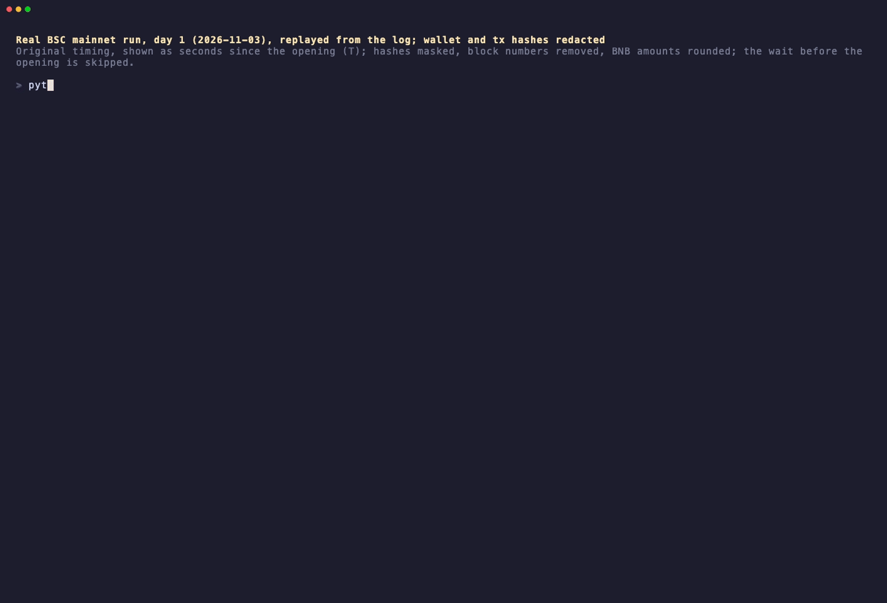
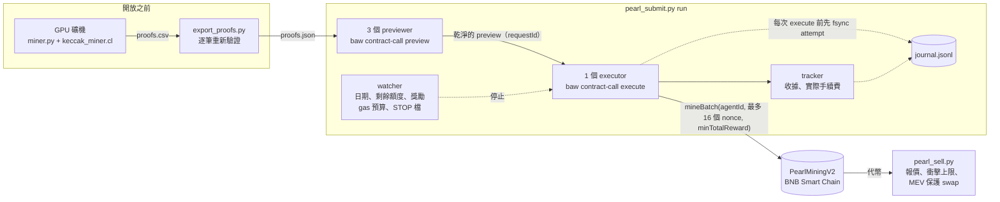

<div align="center">

# pearl-miner

**用 GPU 預先挖好 PearlMiningV2（珍珠币）的 proof，在每日額度開放的那一秒，透過幣安 Agentic Wallet 送上 BSC；同一個 proof 絕不重送，gas 絕不超過你設的上限。**

[](LICENSE)


[English](README.md) · 繁體中文



*BSC 主網第 1 天（2026-11-03）的真實送單，依原始紀錄以原速重播。時間以「開放後幾秒」顯示；錢包與交易雜湊已遮蔽，區塊高度已移除，BNB 金額已四捨五入。從開放到當日額度用完約一分鐘。（[MP4](demo/mainnet-replay.mp4)）*

</div>

---

## 一鍵開始

挖好 proof 之後，開放前執行一行：

```bash
python3 pearl.py auto
```

它會檢查錢包和 proof、列出計畫（開放時間、Gas 上限、賣出比例），你輸入 `yes` 之後就不用管：等到開放、自動送單、額度滿了自動停，再自動賣出，最多賣到本次 proof 可能賺到的量的 80%（`--sell off` 可關閉）。只在正常結束時才賣。這個上限是挖到的 proof 數 × 開始前讀到的獎勵，獎勵只會往下掉，所以原本持有的幣最多只會被賣到「上限與實際獎勵之差」的 80%。

- 新手照做：[docs/QUICKSTART.zh-TW.md](docs/QUICKSTART.zh-TW.md)
- 交給 AI Agent（Claude Code、Codex、Grok Bot 等）：[docs/AGENTS-SETUP.zh-TW.md](docs/AGENTS-SETUP.zh-TW.md)，skill 在 [skills/pearl-miner/SKILL.md](skills/pearl-miner/SKILL.md)
- macOS、Windows、Linux 與各種顯示卡：[docs/PLATFORMS.zh-TW.md](docs/PLATFORMS.zh-TW.md)

---

## 這是什麼

- **代幣是什麼**：[PearlMiningV2](docs/CONTRACT.md)（代幣名稱與代號都是「**珍珠币**」）是 BNB Smart Chain（BSC，幣安智能鏈）上的工作量證明（PoW）代幣。持有幣安 **[Agent ID](#名詞對照表)** 的人，可以先在鏈下用顯示卡（GPU）算出合格解答（稱為 **[proof](#名詞對照表)**），再上鏈領幣，每筆交易最多打包 **16 個 proof**。
- **每天何時開放**：全網設有 **[每日額度（daily cap）](#名詞對照表) 2,000 萬枚**，每天固定在同一秒——**19:08:54 UTC+8（11:08:54 UTC）**——準時開放，所有提前囤好 proof 的人會在那一秒同時開搶。
- **本工具做什麼**：這個 repo 是實際在 BSC 主網跑過的整套自動化工具，包辦「GPU 挖礦 → 驗證匯出 → **[本機分叉模擬（fork simulation）](#名詞對照表)**（免費演練）→ 開放時透過幣安 **[Agentic Wallet](#名詞對照表)**（[`baw`](#名詞對照表) CLI）自動搶額度送單 → **[MEV](#名詞對照表)** 保護分批賣出」。
- **為什麼可以提前挖好**：因為合約計算 proof 時，種子（`seed`）只綁定你的**錢包地址**，**不綁定日期，也不會過期**。只要某個 proof 還沒在鏈上領過，今天沒搶到，明天、後天都還能繼續用（約第 4 天後難度會提高，見 [CONTRACT.md](docs/CONTRACT.md#difficulty-stages)）。因此，每天 19:08:54 UTC+8 開搶時，比的不是誰當下算得快，而是**誰早就把 proof 準備好存在硬碟裡，並在額度開放時把交易送進區塊鏈**。

**一個錢包實際能搶到多少？**

- 第 1 天（2026-11-03）全網約 59 秒就把 2,000 萬枚搶光（第 0 天花了 70 分 36 秒）。
- 本工具用單一錢包：第一筆在開放後約 3 秒上鏈，共 13 筆交易、領到 192 個 proof，gas 合計約 0.0006 BNB。
- Agentic Wallet 每個地址一次只能有一筆交易在途（約每 4 到 5 秒一筆），所以單一錢包能分到的就是這個量級。詳見[真實數據與預期收益](#真實數據與預期收益)。

---

## 適合誰／不適合誰

### 適合你，如果：

- **你已經持有幣安 Agent ID 與 Agentic Wallet**：你想把手上的 Agent ID 用起來，而且喜歡「全程不需要把私鑰放進電腦」的安全設計。
- **你不會寫程式，但願意照著步驟複製貼上指令**：你不需要改任何一行程式碼。只要能打開終端機（Terminal），照下面的步驟貼上指令、核對螢幕印出的文字即可。
- **你有一張支援 OpenCL 的獨立顯示卡（GPU）**：本文數字都是 RTX 4070 SUPER 實測（每小時約 6,900 個 proof）；其他顯卡請自行實測速度。
- **你對收益有務實預期**：你知道全網每天 2,000 萬枚額度可能約一分鐘就被搶光，只是想用低成本參與（第 1 天約 0.0006 BNB，最多為你設定的 gas 預算）。

### 不適合你，如果：

- **你沒有幣安 Agent ID，或只想用一般私鑰錢包（EOA，例如 MetaMask、Rabby）**：合約強制驗證鏈上 Agent ID 註冊表，沒有 Agent ID 無法領取；且本工具是專為 `baw` CLI 的 `preview` / `execute` 流程與「一次一筆」規則打造的，無法直接改接一般私鑰錢包。
- **你期待穩定高收益或暴利**：自備私鑰的對手可以同時送出多筆在途交易，但 Agentic Wallet 每個地址一次只能跑一筆；而且代幣只在單一流動性池交易，第 1 天開放後 **14 分鐘內價格就跌了約 51%**，幣價隨時可能歸零。
- **你不想操作命令列（CLI）或安裝驅動程式**：工具雖然已把複雜流程全自動化，仍需在終端機執行 Python 指令。

---

## 事前準備清單（預估時間與成本）

開始前請先準備好以下項目。以 **RTX 4070 SUPER** 顯示卡為例，算力**約 2 GH/s**，平均**每秒約 1.9 個 proof**，換算下來**每小時約可挖 6,900 個 proof**（第 1 天額度 59 秒就滿，單一錢包只用掉 192 個 proof；但每天窗口長短不同，第 0 天開了 70 分 36 秒，那種日子一個錢包可能用掉上萬個。預設 gas 預算最多約能送 900 筆、約 14,000 個 proof，建議至少先挖 1–2 小時；沒用到的 proof 不會過期）：

| 準備項目 | 用途與說明 | 準備時間 | 預估成本 |
|---|---|---|---|
| **1. 幣安 Agent ID 與 Agentic Wallet（`baw` CLI）** | 安裝官方 `baw` CLI、登入帳號、在手機幣安 App 完成配對（狀態需為 `CONNECTED`），並開啟 Developer Mode。官方教學與 skills：[binance/binance-skills-hub](https://github.com/binance/binance-skills-hub)。 | 首次安裝配對僅需幾分鐘 | 免費（需已持有 Agent ID） |
| **2. 錢包裡的少量 BNB** | 放在 Agentic Wallet（BSC 鏈）裡付 gas。送單器預設保留 `--keep-bnb 0.005` BNB 不動、預算上限 `--budget-bnb 0.045` BNB（第 1 天實測錢包起始餘額約 `0.05 BNB`）；賣出器要求至少有 `--min-bnb 0.002` BNB。實測第 1 天 13 筆交易總共只花**約 0.0006 BNB**。 | 轉帳僅需幾分鐘 | 第 1 天實測約 0.0006 BNB；單輪最多可花到 `--budget-bnb`（預設 0.045 BNB） |
| **3. Python 3.9 以上** | 送單器（`pearl_submit.py`）、賣出器（`pearl_sell.py`）與驗證匯出工具（`export_proofs.py`）**只用 Python 內建標準函式庫**，不需安裝第三方套件（若裝有 `pycryptodome`，`export_proofs.py` 會更快，`miner/requirements.txt` 會一起裝）。 | 多數電腦已內建 | 免費 |
| **4. OpenCL GPU 與挖礦套件** | 挖礦需支援 OpenCL 的 GPU，並執行 `pip install -r miner/requirements.txt`（安裝 `numpy`、`pyopencl`、`pycryptodome`）。RTX 4070 SUPER 每小時約產出 **6,900 個 proof**。 | 建議至少挖 1–2 小時 | 僅顯示卡電費 |
| **5. Foundry 的 `anvil`（選用，強烈建議）** | 用來跑「本機分叉模擬」（步驟 5），在自己電腦上免費演練一次完整的開搶流程。從 [getfoundry.sh](https://getfoundry.sh) 安裝。 | 單次模擬約 2 分鐘 | 免費（0 BNB） |

---

## 名詞對照表

第一次看到這些詞不用擔心，這裡用白話解釋：

- **`proof`（工作量證明／合格解答）**：你的顯示卡拿錢包專屬種子（`seed`）與隨機數（`nonce`）算出的合格雜湊解答（公式見[技術細節](#技術細節與架構)）。你可以把它當成「綁定你錢包地址、不會過期、但每張只能用一次」的領幣兌換券。
- **`Agent ID`**：幣安發行的鏈上身分（BSC 註冊表合約 `0x60B9262456dE011F7d15a54CdD8c48bAaa8B022F` 上的 ERC-721 代幣）。網頁或 App 上常顯示為 `yourhandle.ai`，但合約裡存的原始名稱（`handle`）**不包含 `.ai`**，且只能是 3 到 20 個小寫英數字（`a-z` 與 `0-9`）。
- **`Agentic Wallet`**：幣安推出的無私鑰 MPC（多方計算）錢包。你的電腦上完全沒有私鑰，所有交易都由官方命令列工具送往錢包後端模擬、做風險檢查並簽名送出。
- **`baw`**：Binance Agentic Wallet 的官方命令列工具（CLI）。本工具透過呼叫 `baw` 執行預覽模擬（`baw contract-call preview`）、送出交易（`baw contract-call execute`）以及查價與賣幣（`baw market-order quote` / `swap`）。
- **`gas`（鏈上手續費）**：在 BNB Smart Chain（BSC）發送交易給驗證者的 BNB 手續費。每個 proof 約耗 35.7k gas，一筆 16 個 proof 的交易約 570k gas（在 0.08–0.10 gwei 時約 0.000045–0.000055 BNB）；若因額度剛滿而失敗退回（revert），只花約 0.000006 BNB。
- **`daily cap`（每日額度）**：合約規定每天全網最多只能挖出 **2,000 萬枚**珍珠币（總供應量 10 億枚的 1/50）。每天固定在 **19:08:54 UTC+8（11:08:54 UTC）** 開放，搶光就要等隔天同一秒。
- **`journal`（交易帳本／日誌檔）**：程式用來防止「同一個 proof 重複送出」的本機紀錄檔（預設為 `submit/journal.jsonl`，賣出器則為 `submit/sell.jsonl`）。每次呼叫 `execute` 送出交易**之前**，程式一定會先把 `attempt` 紀錄強制寫入硬碟（`fsync`）鎖住那批 proof；除非之後收據（receipt）證明該筆交易 revert，或錢包在廣播前以 `351716` 拒絕（沒送出），否則這些 proof 永遠不會再送第二次。中途當機重開時，程式會自動重放 journal 接續進度。
- **`fork simulation`（分叉模擬）**：利用 Foundry 的 `anvil` 在你電腦記憶體裡複製一份真實的 BSC 主網合約，搭配只連本機 `127.0.0.1` 的假 `baw`，模擬「現場換日開放 + 對手同時搶吃額度」的完整過程。完全不花真錢、也不需要私鑰。
- **`MEV`（最大可提取價值／防夾保護）**：在鏈上買賣代幣時，常有套利機器人看到你的交易就搶先買入再賣出吃價差（俗稱「夾子」或三明治攻擊）。賣出工具 `pearl_sell.py` 會開啟錢包的 MEV 保護（程式內部傳給 `baw` 的 `--mev true`，不需要自己加），並限制單批相對當下價格的衝擊（預設 50%，`--max-impact 0.5`）、絕不低於開始賣時價格的一半（`--floor 0.5`），以及滑價（預設 3%，`--slippage 3`）。池子非常薄：11/4 賣 23,958 枚的衝擊是 42%，v0.1.3（含）以前的 2% 上限會一枚都賣不掉，而開盤後 4.5 分鐘價格就跌了 88%。

---

## 一步一步照著做

### 步驟 0：下載專案並設定錢包地址與 handle

- **這一步在做什麼**：把程式碼下載到電腦，並在終端機設定你的 Agentic Wallet 地址（`PEARL_WALLET`）與 Agent ID 原始名稱（`PEARL_HANDLE`）。
- **指令**：
  ```sh
  git clone https://gitlab.com/aa22396584/pearl-miner.git && cd pearl-miner
  export PEARL_WALLET=0x你的AgenticWallet地址
  export PEARL_HANDLE=yourhandle            # Agent ID 的原始 handle：只有 a-z 與 0-9，不要加 ".ai"
  ```
  `agentId` 與挖礦用的 `seed` 程式會自動算，你不用管（計算公式見[技術細節](#技術細節與架構)）。每個工具也都可以用 `--wallet`（需要時加 `--handle`）取代環境變數。兩者在任何動作之前都會先檢查，**程式不會自動替你修正**：錢包必須是 `0x` 加 40 個十六進位字元（大小寫混用時必須是正確的 EIP-55 checksum），`handle` 必須符合註冊表自己的規則（3 到 20 個字元，只有 `a-z` 與 `0-9`，不含 `.ai`）。
- **常見錯誤與處理**：
  - `set the wallet address with --wallet or PEARL_WALLET (expected 0x followed by 40 hex digits; got ...)`：地址長度或開頭不對，請確認是 `0x` 加上 40 個十六進位字元。
  - `mixed case with a wrong EIP-55 checksum: a typo, or a different address`：地址大小寫混用但校驗碼不符（代表有字母打錯），請從錢包重新複製完整地址。
  - `set the raw Agent ID handle with --handle or PEARL_HANDLE (pass the raw handle without the display '.ai' suffix; got 'yourhandle.ai')`：請把 `.ai` 拿掉，只填 `yourhandle`。
  - `contains upper-case letters; registered handles are lower case` 或 `contains whitespace`：請改成全小寫、去掉空白。
- **花費時間**：不到 1 分鐘。**建議在花 GPU 時間挖礦前，先跳到「步驟 3」跑一次 `check`**：就算還沒有 proofs 檔，它照樣會讀鏈上註冊表，確認這個 handle 真的屬於你的錢包。

---

### 步驟 1：用 GPU 挖礦（開放前任何時候都可以；proof 不會過期）

- **這一步在做什麼**：先用 `--test` 跑一次 GPU kernel 自我測試，把至少 2,000 筆（預設設定下是 2,048 筆）GPU 結果在 CPU 上重算確認；接著啟動正式挖礦，將找到並經 CPU 重算通過的 proof 持續寫入 `miner/proofs.csv`。
- **指令**：
  ```sh
  pip install -r miner/requirements.txt            # 首次挖礦前安裝 numpy、pyopencl、pycryptodome
  python3 miner/miner.py --test                    # kernel 自我測試，結果在 CPU 上重算
  python3 miner/miner.py --out miner/proofs.csv    # 一直跑，直到你執行：touch miner/STOP
  ```
- **成功時會看到什麼**：
  - 執行 `--test` 時，最後會印出 `TEST OK`：
    ```text
    seed=0x... device=... prefix=0x... mask=0xfff per_launch=268435456
    WARNING: 65... hits in one launch, only 1024 kept
    WARNING: 65... hits in one launch, only 1024 kept
    TEST OK: 2048 GPU hits re-verified on CPU (mask 0xfff), expected ~131072
    ```
    自我測試用很低的難度，每輪命中數超過 1,024 筆的緩衝，所以印出兩行 `WARNING … only 1024 kept` 是正常的。
  - 正式挖礦時，每 30 秒會印出一行進度；當你在另一個視窗執行 `touch miner/STOP` 後，會印出 `stopping` 並安全結束：
    ```text
    seed=0x... device=... prefix=0x... mask=0xfcffffff per_launch=268435456
    HH:MM:SS rate=2040.0MH/s proofs=57 hashes=...
    stopping: proofs=...
    ```
- **常見錯誤與處理**：
  - `no OpenCL GPU found`：找不到支援 OpenCL 的顯示卡，請安裝顯示卡驅動與 OpenCL runtime。
  - `give --wallet (or set PEARL_WALLET) or --seed`：尚未設定 `PEARL_WALLET` 環境變數，也沒有傳 `--wallet`。
  - `--seed is not puzzleSeed(--wallet / PEARL_WALLET): proofs would be useless; give only one of them, or fix the one that is wrong`：同時給了 `--seed` 與 `--wallet` 且兩者不一致；只給 `--wallet`（或 `PEARL_WALLET`）即可。
  - `KERNEL MISMATCH ctr=... hash=0x...`：GPU 算出的雜湊與 CPU 驗算不符（例如顯卡超頻不穩），程式會立即中止，不會把錯誤資料寫入 CSV。
  - **提醒**：用 `touch miner/STOP` 停下後，下次要繼續挖之前請先刪掉 `rm miner/STOP`。
- **花費時間**：`--test` 僅需幾秒鐘。正式挖礦在 RTX 4070 SUPER（約 2 GH/s）上每秒約產出 1.9 個 proof（每小時約 6,900 個）；第 1 天在不到一分鐘的開放窗口內只用掉 192 個 proof（額度 59 秒就滿），但像第 0 天（70 分 36 秒）那樣窗口長的日子可能用掉上萬個；預設 gas 預算最多約能送 900 筆（約 14,000 個 proof），建議至少先挖 1–2 小時，沒用到的 proof 不會過期，多挖的隔天還能用。

---

### 步驟 2：匯出並驗證（`proofs.csv` → `proofs.json`）

- **這一步在做什麼**：依你的錢包地址重新算出 `seed`，逐筆重算 `miner/proofs.csv` 裡的每一個 proof，剔除重複或不合格的項目，並以原子方式寫入送單器要讀的 `submit/proofs.json`。
- **指令**：
  ```sh
  python3 submit/export_proofs.py miner/proofs.csv  # -> submit/proofs.json，每個 proof 重新雜湊
  ```
- **成功時會看到什麼**：
  ```text
  6900 verified unique proofs -> /…/pearl-miner/submit/proofs.json; rejected 0
  ```
- **常見錯誤與處理**：
  - `set the wallet address with --wallet or PEARL_WALLET (...)`：請先 `export PEARL_WALLET=0x...` 或加上 `--wallet 0x...`。
  - `rejected` 數字不是 `0`（甚至全部被拒絕）：代表 CSV 裡的 proof 不是用這個 `PEARL_WALLET` 挖的。請確認挖礦與匯出設定的是同一個錢包地址。
- **花費時間**：安裝 `pycryptodome` 時幾千筆只需不到 1 秒；沒裝 `pycryptodome` 會慢很多。

---

### 步驟 3：檢查（唯讀，不送任何交易）

- **這一步在做什麼**：向鏈上註冊表確認 `handle` 屬於你的錢包、檢查 `baw` 連線狀態（必須是 `CONNECTED`）、設定與 `tx-lock`、核對本機時鐘與區塊時間、確認合約 `owner()` 已銷毀且未暫停、查看 BNB 餘額與下一天的獎勵下限；若 `submit/proofs.json` 已存在，還會抽查 proof 是否未曾使用，並從你的錢包透過 `eth_call` 模擬一次領幣呼叫。
- **指令**：
  ```sh
  python3 submit/pearl_submit.py check                  # 最後一行必須是：CHECK OK
  ```
- **成功時會看到什麼**（節錄。真實輸出每行開頭有 `HH:MM:SS.mmm`。）：
  ```text
  wallet 0x...; agentId = keccak256('yourhandle') = 0x...
  registry ownerOf(agentId) = 0x...; matches the wallet: True
  wallet session: CONNECTED (must be CONNECTED; otherwise re-pair with the Binance App)
  miningDay=1 dailyRemaining=0.00 currentReward=91.3086
  min reward per proof for day 2: 86.2400 (computed for the day)
  owner burned (nobody can pause/resume): True; paused now: False
  BNB balance 0.050000
  next day opens at unix 1793790534 = ... local, in ...s
  proof 0x00000000... used=False
  eth_call mineBatch(16) from wallet now: revert DailyLimitReached (DailyLimitReached before the day opens means identity and proofs pass)
  proofs file: 6900 unique proofs
  CHECK OK
  ```
  *(註：還沒挖礦、沒有 `submit/proofs.json` 時執行，會顯示 `no proofs file at .../submit/proofs.json yet: identity and chain checks only`，只要身分與連線正常，最後一行一樣是 `CHECK OK`。另外，開放前看到 `revert DailyLimitReached` 代表你的身分與 proof 都已經通過合約前段檢查，只差每日額度還沒開放，這是正常的通過狀態！)*
- **常見錯誤與處理**：
  - 最後一行是 `CHECK HAS PROBLEMS`：請往上看哪一項檢查是 `False`：
    - `registry ownerOf(agentId) = none (handle not registered)` 或 `matches the wallet: False`：你的 `PEARL_HANDLE` 或 `PEARL_WALLET` 填錯了。
    - `wallet session: UNCONNECTED (must be CONNECTED; otherwise re-pair with the Binance App)`：`baw` 尚未連線，請與手機幣安 App 重新配對。
    - `baw not found on PATH`：找不到 `baw` 指令，請先安裝並設定好 `baw` CLI。
    - `eth_call mineBatch(16) from wallet now: revert InvalidSolution`：proof 不符合目前難度階段（例如第 4 天累計滿 9,000 萬枚進入第 1 階段後，未先過濾舊 proof）。
- **花費時間**：僅需數秒鐘（完全唯讀，0 BNB）。

---

### 步驟 4：用真錢包演練（轉 0 枚給自己三次；會花一點 gas）

- **這一步在做什麼**（建議先完成步驟 5）：透過 `baw` 預覽並連續送出 3 筆（預設 `--parallel 3`）「轉 0 枚珍珠币給自己（`transfer(self, 0)`）」的無害交易，實測你的錢包 session 能不能在不跳出手機 App 確認（`requireConfirmation=False`）的情況下完成預覽與廣播，並觀察錢包後端對連續送單（`--back-to-back`）的反應。
- **指令**：
  ```sh
  python3 submit/pearl_submit.py rehearse --back-to-back
  ```
- **成功時會看到什麼**（節錄。真實輸出每行開頭有 `HH:MM:SS.mmm`。）：
  ```text
  rehearsal: 3 x transfer(self, 0); previews concurrently, then executes back to back (each starts when the previous execute returns, without waiting for its receipt)
  #0 preview ...s ok  gasLimit=... requireConfirmation=False risks={"riskDetails": [], "addresses": {}, "riskBehaviors": []}
  ...
  RESULT nonces [...] distinct=True sent=.../3
  BACK-TO-BACK: proven accepted while pending=..., rejected 351716=..., inconclusive=... -> ...
  tx-lock after: ...
  ```
  *(註：因為錢包後端同一個地址一次只處理一筆交易，第 2、3 筆若在上一筆還沒上鏈時送出，可能會收到 `351716` 並顯示 `KEEP --settle DEFAULT: an execute was rejected while the previous tx was in progress`。這是正常現象，也是為什麼正式送單 `run` 在交易之間最多會等 `--settle 3.0` 秒。)*
- **常見錯誤與處理**：
  - `not every preview was clean; executing none`：預覽失敗，或 `requireConfirmation=True`。後者表示錢包要你在手機幣安 App 確認——幣安的外部簽名流程本來就預期使用者在預覽後確認。本工具不會、也無法替你按確認，遇到時一筆都不送。幣安沒有認可這種無人值守的送單方式；要不要改錢包設定由你自己決定，改之前請先讀服務條款（見免責聲明）。
- **花費時間**：約十幾秒（每筆收據最長等 90 秒；花費最多 3 筆 0 枚轉帳的微量 gas）。

---

### 步驟 5：在本機分叉上模擬整個流程（不送任何東西、不需要私鑰）

- **這一步在做什麼**：用 `anvil` 在本機記憶體分叉出真實 BSC 主網與真合約、在本機分叉上模擬成你的錢包地址（anvil 的 impersonation 功能）、搭配只連 `127.0.0.1` 的假 `baw`，把時間撥到開放前 30 秒，完整演練「倒數換日 → 自動送單 → 對手每秒搶吃 4 個 proof 額度 → 額度滿自動停機 → 最後五項核對」。
- **指令**：
  ```sh
  python3 submit/fork_rehearsal/run_fork.py --cap-proofs 400 --competitor-rate 4 --minutes 3
  # ... FORK REHEARSAL: PASS
  ```
  要分享或錄下輸出時請加 `--anonymize`：它會遮蔽你的地址與交易雜湊。
- **成功時會看到什麼**：
  ```text
  ==== FORK REHEARSAL RESULT ====
  exit=0 wall=...s fork_block=... journal=...
  txs broadcast=... ok=... reverted=... no_receipt=0
  proofs in ok txs=...; marked used on chain=...
  competitor ate ... proofs; chain now day=... remaining=... reward=...
  journal replay: blocked=... fees=... BNB reserved=0 open=[] used=0
  balance on fork: 0.049900 -> ... BNB (spent ...)
  stop reason: ['day ... budget full (remaining ... < reward ...)']
    [PASS] all ok-tx proofs used on chain
    [PASS] replay: nothing reserved or open
    [PASS] fees match spend
    [PASS] stopped for cap full
    [PASS] sent something
  FORK REHEARSAL: PASS
  ```
- **常見錯誤與處理**：
  - `port 8547 is already in use (another anvil?): free it or pass --port`：本機埠 8547 已被占用，請關閉舊的 `anvil` 或用 `--port` 指定另一個未使用的埠號（1024 到 65535）。
  - `no proofs file at .../submit/proofs.json: mine and export first, or pass --proofs`：請先跑完步驟 1 與步驟 2。
  - `anvil did not answer in 30 s`：請確認已安裝 Foundry 的 `anvil` 且網路可連上 BSC RPC。
- **花費時間**：約 2 分鐘（含開放前 30 秒倒數；完全在本機模擬，0 BNB）。

---

### 步驟 6：正式送單（開放前幾分鐘啟動，它會自己等）

- **這一步在做什麼**：在每日開放（**19:08:54 UTC+8 = 11:08:54 UTC**）前幾分鐘啟動背景程序。它會先確認錢包連線為 `CONNECTED`、鎖定 `submit/journal.jsonl`，自動等到換日前 0.6 秒開始預覽，並在鏈上換日成功後連續送出 16 個 proof 的批次，直到當日額度滿、gas 預算到達上限或收到停止訊號為止。
- **指令**：
  ```sh
  nohup python3 submit/pearl_submit.py run > submit/run.log 2>&1 & echo $! > submit/run.pid
  tail -f submit/run.log                            # 隨時可停：touch submit/STOP
  ```
  不加 `--day` 時，程式會等下一次開放。第 *N* 天在 `1793617734 + N × 86400` 開放（每天 **11:08:54 UTC，即 19:08:54 UTC+8**；第 0 天是 2026-11-02）；要等更後面的某一天，就加 `--day N`。如果指定的那一天送單時段（`--minutes`，預設 90 分鐘）已經過了，程式會拒絕執行。`echo $! > submit/run.pid` 請保留：賣出器靠這個檔案判斷送單已經結束。

  每個 proof 的獎勵隨每一次領取遞減，所以 `minTotalReward` 的下限會依目標日自動計算：當天可能的最低獎勵再打 99 折（**第 1 天 90.40、第 2 天 86.24、第 3 天 82.18**；見 [CONTRACT.md](docs/CONTRACT.md#reward-per-proof)）。`--min-reward`（至少 1 枚）可以覆寫。從第 44 天起，每日上限已經無法替獎勵定出下限，算出來的下限是 0，程式會提醒你；那時請自己加 `--min-reward`。
- **成功時會看到什麼**（節錄。真實輸出每行開頭有 `HH:MM:SS.mmm`。這個範例取自去識別化的 `demo/day1-mainnet.log`：BNB 金額以 `~` 四捨五入（真實輸出印 6 到 7 位小數），收據行的 `block N` 也已移除。）：
  ```text
  wallet session CONNECTED
  owner burned (nobody can pause/resume): True
  run: 28063 usable proofs in 1754 batches (0 blocked); balance ~0.05 BNB, fees so far ~0, effective budget ~0.04, keep 0.005; previewers 3, executors 1; day 1 opens unix 1793704134 (851s from now)
  chain is on day 1: open (remaining 20000000, reward 95.6049)
  tx#1 broadcast 0x... (16 proofs, execute 2.10s)
  receipt 0x... status 1 mined 16 fee ~0.00005
  ...
  STOP: day 1 budget full (remaining 16.00 < reward 91.31)
  SUMMARY txs=13 proofs_mined=192 reverted=1 fees=~0.0006 BNB stop=day 1 budget full (remaining 16.00 < reward 91.31)
  ```
  *(註：`day 1 budget full (remaining 16.00 < reward 91.31)` 指的是當日額度剩下的量不夠一個 proof 的獎勵，不是 gas 預算用完。)*
- **常見錯誤與處理**：
  - `baw wallet session is 'UNCONNECTED', not CONNECTED: re-pair with the Binance App, then start again`：錢包連線中斷，請重新與幣安 App 配對後再啟動。
  - `another run already holds .../submit/journal.jsonl; refusing to start a second sender`：已經有一個送單器在跑，檔案鎖擋下了第二個程序。
  - `--day N opened at unix ... and its 90-minute window is over; leave out --day to wait for the next opening`：指定的天數已經結束，拿掉 `--day` 即可自動對準下一次開放。
  - `STOP: STOP file`：資料夾裡有舊的 `submit/STOP` 檔，下次啟動前請先 `rm submit/STOP`。
  - `STOP: unexpected simulation failure: InvalidSolution`：你的 proof 在目前難度階段已不合格（第 4 天滿 9,000 萬枚後難度升為 1.5 倍），請先過濾 proof。
  - `STOP: unexpected simulation failure: RewardChanged`：單個 proof 獎勵低於你設的 `--min-reward`，請拿掉 `--min-reward` 讓程式自動計算當日下限。
- **花費時間**：開放前提前幾分鐘啟動等待；第 1 天不到一分鐘搶完，花費約 0.0006 BNB。**但額度若像第 0 天那樣 70 分鐘才滿，程式會一直送到 gas 預算用完，最多花掉 `--budget-bnb`（預設 0.045 BNB）；想少花請調低 `--budget-bnb`。**

---

### 步驟 7：賣出一部分（送單結束之後才可以）

- **這一步在做什麼**：透過 `baw market-order` 把挖到的珍珠币分批換回 BNB。預設賣出 **80%**（`--fraction 0.8`）、保留 20%，每批最多 **10 萬枚**（`--chunk 100000`），每批先查 1,000 枚小額參考報價，單批相對當下價格的衝擊超過 **50%**（`--max-impact 0.5`），或價格低於開始賣時的**一半**（`--floor 0.5`，避免一批接一批把價格越賣越低），就自動折半；連最小批 2 萬枚都超過時，`--mode now` 會直接停下，不再繼續賣。另外開啟 MEV 保護（程式內部傳給 `baw` 的 `--mev true`，不需要自己加）與 **3%** 滑價上限（`--slippage 3`）。50% 聽起來很高，但池子就是這麼薄：11/4 用 2% 上限會一枚都賣不掉，同時價格跌了 88%。
- **重要限制**：
  1. `submit/run.pid` 的程序還活著，或這個檔案不存在時，賣出器都會拒絕執行，所以請照步驟 6 的方式啟動送單（**切勿手動建立 `run.pid`**）。
  2. `PEARL_WALLET` 必須就是 `baw` 目前登入的錢包（程式會用 `baw wallet address` 查），否則也會拒絕：因為餘額是讀你給的地址，但賣出交易是從登入的錢包送出。
  3. 第 1 天開放後 14 分鐘內價格跌了約 51%，價格可能很快下跌。若不想承擔這段價格風險可用 `--mode now` 立刻分批賣；預設的 `--mode trail` 則是依池子歷史設計的分批策略。兩者都可能虧損。
- **指令**：
  ```sh
  python3 submit/pearl_sell.py plan                 # 唯讀：餘額、要賣的數量、一次參考報價
  python3 submit/pearl_sell.py run --dry-run        # 真實報價、模擬成交，不送出
  python3 submit/pearl_sell.py run --mode now       # 立刻賣出 80%，每批最多 10 萬枚
  ```
- **成功時會看到什麼**：
  - 執行 `plan` 時：
    ```text
    HH:MM:SS wallet 0x... holds ... 珍珠币; selling 80% = ... coins in chunks of up to 100,000
    HH:MM:SS reference quote 1000 coins: {"success": true, ...}
    HH:MM:SS ≈ ... BNB per coin; whole sale ≈ ... BNB before impact
    HH:MM:SS mining run alive: False
    HH:MM:SS baw is signed in to 0x...; matches --wallet: True
    ```
  - 執行 `run --mode now` 時（啟動後會先等 30 秒確認代幣餘額穩定不再變動，再開始報價與賣出）：
    ```text
    HH:MM:SS start balance ...; keeping ...; selling ...
    HH:MM:SS [now] quote ... coins -> ... BNB (impact ...%)
    HH:MM:SS order ... FINISHED: balance fell by ... coins for ... BNB, tx 0x...
    HH:MM:SS done: ... coins left above the kept ...
    HH:MM:SS end balance ... 珍珠币 (sold ...); BNB from finished orders ≈ ...
    ```
- **常見錯誤與處理**：
  - `the mining run may still be alive (.../submit/run.pid missing or its process running): sell only after it has finished; never create run.pid by hand`：請確認步驟 6 的送單程序已經結束，且 `submit/run.pid` 存在。
  - `--wallet 0x... is not the wallet baw is signed in to (...): refusing to sell`：`PEARL_WALLET` 與 `baw` 登入的錢包不同，請修正。
  - `less than 0.002 BNB for gas`：錢包 BNB 餘額低於 `--min-bnb`（預設 0.002 BNB）。
  - `a 珍珠币 market order is PENDING (or the order list is unreadable): resolve it first`：已有掛單處理中，請先用 `baw market-order list --status PENDING` 確認。
  - `swap without an orderId ...: stopping` 或 `order ... has no terminal status after 150s: stopping`：訂單狀態不明時程式會立刻停下、絕不重送；請先檢查 `baw market-order list` 與鏈上餘額。
  - `STOP file: stopping`：`submit/STOP` 還在（例如你用它停過送單），請先 `rm submit/STOP`。
- **花費時間**：`plan` 僅需數秒；`run --mode now` 啟動時會先等待 30 秒確認餘額穩定，單批交易通常在 1 分鐘內完成，若分多批則每批之間至少間隔 60 秒（`--gap 60`）。

---

## 安全機制

### 白話版：這套工具怎麼保護你的錢包與 gas？

1. **同一個 proof 絕對不會送兩次**：每次呼叫 `execute` 送出交易前，送單器都會先把那 16 個 proof 的 `attempt` 紀錄寫進硬碟上的 `journal.jsonl` 並強制存檔（`fsync`）。除非之後收據證明那筆交易在鏈上失敗退回（revert），或錢包後端在廣播前就以 `351716` 拒絕，否則那些 proof 就會永遠鎖住——就算電腦中途斷電、當機重開，也不會重複送出白花 gas。
2. **有疑慮就立刻停下，絕不硬猜**：不管是錢包預覽跳出任何風險提示、要求手機 App 確認、回應不完整，或是出現無法解釋的模擬失敗，程式都會直接停機，不會拿你的 BNB 去賭。
3. **雙重控制 gas 花費**：花費上限為 `min(--budget-bnb, 起始餘額 − --keep-bnb)`（預設 `--budget-bnb 0.045` BNB、`--keep-bnb 0.005` BNB），計入已付手續費、結果未知交易的保留額，以及所有在途交易 1.5 倍的估算值，保證不會超支。
4. **額度快滿時自動切小批**：一筆 16 個 proof 的交易只要有 1 個塞不進當日剩餘額度，整筆 16 個都會一起失敗退回。所以在接近 2,000 萬枚上限時，程式每次送出前都會重讀鏈上剩餘空間、扣掉自己在途的 proof，自動把批次切成剛好塞得下的大小。
5. **賣幣防夾、防砸盤、防重複下單**：賣出器會先確認挖礦送單已結束且 `baw` 登入的錢包就是 `--wallet`，每批先跟 1,000 枚小額參考報價比對，單批衝擊超過 50% 或價格低於開始賣時的一半就自動減半（`--mode now` 連最小批都超過就停下，不再繼續賣），並開啟錢包的 MEV 保護；完全以「鏈上真實餘額下降」來計算進度，遇到狀態不明的訂單立刻停下，絕不盲目補單。

### 技術總覽表

| 防護 | 作用 |
|---|---|
| **開放寬限期限** | 開放時錢包的模擬器可能落後一個區塊。只有在我們自己的 `eth_call` 成功，**而且**錢包在 30 秒內重新 preview 同一份 calldata 並核准時，失敗的 preview 才算「落後」；期間 executor 一律不送。寬限過後不再重新分類，直接停止。 |
| **preview 有任何風險就停** | preview 裡有任何風險項目、風險地址或風險行為、`requireConfirmation`、回應不完整，或出現預期之外的 revert 原因，都會停止。 |
| **gas 預算與保留額** | 花費上限是 `min(--budget-bnb, 起始餘額 − --keep-bnb)`，計入實際手續費、結果未知交易的保留額，以及所有在途交易 1.5 倍的估計值。 |
| **單一 executor** | 只有一個執行緒會呼叫 `execute`，而且是在與 `stop()` 同一把鎖下檢查 gate 後才啟動。`--executors` 不是 1 會直接拒絕。 |
| **以 journal 保證重啟安全** | 每次 execute 前先 fsync 一筆 `attempt`。其中的 proof 會一直鎖住，直到收據證明那筆交易 revert，或錢包在廣播前以 `351716` 拒絕（沒送出）。重啟時重放 journal；檔案鎖會擋下第二個送單程式。 |
| **STOP 檔** | `touch submit/STOP`（或 Ctrl-C / SIGTERM、或截止時間）會在步驟之間停止。賣出器也看同一個 STOP 檔。下次啟動前要刪掉。 |
| **接近上限時切批** | 接近上限時，每次送出前重新讀鏈並扣掉自己在途的 proof；整批放不下（會整筆 revert）就切成剛好放得下的大小。 |
| **輸入檢查** | 錢包必須是 `0x` 加 40 個十六進位字元，大小寫混用時必須是正確的 EIP-55 checksum；handle 必須符合註冊表的 `isValidHandle`（`a-z0-9`，3 到 20 個字元）；同時給 `--seed` 與 `--wallet` 時兩者必須一致；`--min-reward` 至少 1 枚。`check` 會在鏈上確認 handle 屬於這個錢包；`--wallet` 不是 `baw` 登入的錢包時，賣出器會拒絕執行。 |
| **MEV 保護賣出與衝擊上限** | 每一批都先和小額參考報價比較，單批衝擊超過 50% 或價格低於開始賣時的一半就減半（`--mode now` 連最小批都超過就停下，不再繼續賣）。swap 使用錢包的 MEV 保護與滑價上限；狀態不明的訂單絕不重送。 |

---

## 真實數據與預期收益

以下是 BSC 主網上的真實紀錄，不是收益保證。

| | 第 0 天（2026-11-02） | 第 1 天（2026-11-03） |
|---|---|---|
| 從開放到 2,000 萬枚額度用完（最後一筆成功領取的區塊） | 70 分 36 秒 | **約 59 秒** |

這個工具在第 1 天用**單一錢包**做到的實際成績（就是頁面頂端的重播動畫）：

- 共送出 **13 筆交易**，成功**挖到 192 個 proof**（每個約 91–96 枚，獎勵隨全網領取遞減），第一筆在開放後**約 3 秒**上鏈；
- **1 筆 revert**：最後一筆在額度剛好用完時送出（只花費約 0.000006 BNB）；
- **gas 合計約 0.0006 BNB**；
- 平均每 4 到 5 秒送出一筆，這就是幣安 Agentic Wallet「每個地址同時只能有一筆進行中的交易」的速度上限。

### 你應該知道的現實（這值得花時間嗎？）

- **競爭非常激烈，單一錢包分到的比例很小**：第 1 天額度在**約 59 秒**內就被搶光，比第 0 天（70 分 36 秒）快得多。自己持有私鑰（EOA）的送單者可以同時發好幾筆交易在鏈上排隊，但 Agentic Wallet 後端一次只收一筆。每天能分到的只會是很小的一份。
- **獲利空間很小，而且完全沒有保證**：這個代幣只在單一一個 PancakeSwap Infinity（v4）池子交易（手續費 0.3726%）。任何賣單都會推動價格，而且幣價隨時可能跌到零。第 1 天開放後 14 分鐘內價格跌了約 51%；賣出時機見步驟 7。
- **鏈上手續費不高，而且有上限**：每個 proof 約耗 35.7k gas；第 1 天一整輪 13 筆交易只花約 0.0006 BNB。但額度若像第 0 天那樣 70 分鐘才滿，最多會花到 `--budget-bnb`（預設 0.045 BNB）。其餘成本是預先挖礦的 GPU 電費與你的時間。

---

## 常見問題（FAQ）

**我不會寫程式，也能用嗎？**
可以。你不需要修改任何程式碼，只要在終端機（Terminal）照著上面「一步一步照著做」的順序複製、貼上指令即可。上場前可以先跑免費的 `check`（步驟 3）與本機分叉模擬 `run_fork.py`（步驟 5），看到 `CHECK OK` 與 `FORK REHEARSAL: PASS` 再上場。

**我需要先挖多少個 proof 才夠一天用？**
因為 Agentic Wallet 一次只能有一筆交易在途（每 4 到 5 秒一筆，每筆最多 16 個 proof），第 1 天在不到一分鐘的開放窗口內單一錢包共送出 13 筆交易、只用掉 **192 個 proof**（額度 59 秒就滿）；但像第 0 天（70 分 36 秒）那樣窗口長的日子可能用掉上萬個。預設 gas 預算最多約能送 900 筆（約 14,000 個 proof），以 RTX 4070 SUPER（每秒約 1.9 個 proof，每小時約 6,900 個）來說，建議至少先挖 1–2 小時；沒用到的 proof 不會過期，多挖的隔天還能用。

**需要私鑰嗎？**
不需要。幣安 Agentic Wallet 是 MPC 錢包，工具只呼叫它的 CLI（`baw`）。分叉模擬是在本機分叉上模擬成你的錢包地址（anvil 的 impersonation 功能），同樣不需要私鑰。

**可以改用一般錢包（EOA）嗎？**
這份程式不行：它是圍繞 `baw` 的 preview / execute 流程與「一次一筆」的規則設計的。

**為什麼只有一個 executor？**
錢包後端在有交易進行中時，會拒絕第二個 `execute`（錯誤碼 `351716`）。多開 executor 只會多出被拒絕的呼叫。

**為什麼一筆 16 個 proof？**
這是合約的 `MAX_BATCH`。一筆交易要嘛全部成功、要嘛全部失敗，所以送單器在接近上限時會自動切小批。

**`--handle` 要填什麼？**
註冊表裡的原始 handle，不要加顯示用的 `.ai`：3 到 20 個字元，只有小寫字母與數字（註冊表的 `isValidHandle`）。其他寫法（大寫、空白、`.ai`）工具一律拒絕，不會替你猜。`check` 會讀註冊表，告訴你這個 handle 是否屬於你的錢包；如果它回報 `InvalidIdentity` 或不相符，就是 handle 或錢包填錯了。

**每天幾點要啟動 `pearl_submit.py run`？**
每日額度固定在 **19:08:54 UTC+8（11:08:54 UTC）** 開放。在開放前幾分鐘執行步驟 6 的指令即可，程式啟動後會自己倒數等待，並在換日前 0.6 秒自動開始預覽。

**我的 proof 是前幾天挖的，還能用嗎？**
可以，只要還沒被用過。但累計挖出 9,000 萬枚之後（約第 4 天），難度提高為 1.5 倍，約三分之一的 stage 0 proof 會不再合格，送單器會因 `InvalidSolution` 停止。請先過濾（見 [CONTRACT.md](docs/CONTRACT.md#difficulty-stages)）。

**送單因為 `RewardChanged` 停了。**
每個 proof 的下限高於目前的獎勵。依目標日自動計算的下限不會發生這種情況；如果你有加 `--day` 或 `--min-reward`，請檢查這兩個參數。

**送單中途機器重開了怎麼辦？**
用同一個 `--journal` 再執行一次同樣的指令。可能已送出的 proof 會保持鎖定；在途交易會重新查詢，手續費也會算進去。

**賣出時 `--mode now` 跟預設的 `--mode trail` 差在哪？**
`--mode now` 會在送單結束、等待 30 秒確認餘額穩定後立刻開始分批賣出（每批間隔至少 60 秒，`--gap 60`）。預設的 `--mode trail` 則會每 30 秒（`--poll 30`）查一次參考報價，等價格從起算後高點回落 7%（`--pullback 0.07`）或到達 20–120 分鐘的線性時間表（`--warmup 20`、`--deadline 120`）才賣。兩者都可能虧損。

**分叉模擬真的無害嗎？**
是的。假 `baw` 拒絕連到 `127.0.0.1` 以外的 RPC，送單器的 RPC 清單也只指向分叉；本機埠（8547，或 `--port`）已被其他節點占用時，腳本會拒絕啟動。

**重播為什麼顯示 `T+2.53s` 而不是時間，也沒有區塊高度？**
`tools/replay_log.py --anonymize` 會遮掉紀錄裡的值：雜湊與地址、區塊高度、精確的 BNB 金額、handle、時鐘時間與時區。但它遮不掉這次送單本身：開放的秒數是公開的，所以有心人仍然可以拿 T+ 時間、交易筆數與順序到鏈上比對，上面第 1 天的重播就能用這種方式找到它的錢包。如果你的錢包必須無法被連結，就不要公開送單紀錄。

---

## 技術細節與架構

### 工具總覽

| 階段 | 工具 | 說明 |
|---|---|---|
| 挖礦 | `miner/miner.py` + `keccak_miner.cl` | OpenCL Keccak 礦機，GPU 找到的每一筆都在 CPU 上重算確認 |
| 驗證 | `submit/export_proofs.py` | 依你的錢包逐筆重算 proof，輸出 `proofs.json` |
| 送單 | `submit/pearl_submit.py` | 透過 `baw` CLI 執行 `check` / `rehearse` / `run` |
| 模擬 | `submit/fork_rehearsal/run_fork.py` | 在本機 anvil 分叉上，對真合約跑完整送單流程 |
| 賣出 | `submit/pearl_sell.py` | 先報價、限制價格衝擊、MEV 保護，分批賣出 |
| 重播 | `tools/replay_log.py` | 依原始節奏重播送單紀錄，並去除可識別資訊 |

### 核心設計特點

- **合約公式與 GPU 高速挖礦**：鏈上身分 `agentId = uint256(keccak256(handle))`，挖礦種子 `seed = keccak256(abi.encode(publicChallenge, wallet))`，合格解答 `proof = keccak256(seed ‖ nonce)`（第 0 階段前 30 bits 為 0），領幣呼叫 `mineBatch(agentId, nonces, minTotalReward)`（每筆最多 16 個 proof）。OpenCL 手動展開的 Keccak-f[1600]，RTX 4070 SUPER 約 2 GH/s（每秒約 1.9 個 stage 0 proof，每小時約 6,900 個）。proof 綁錢包、不綁日期，可以提前挖好。
- **開放時自動開始**：previewer 在換日前 0.6 秒開始；主網上第一筆交易在開放後約 3 秒上鏈。
- **流水線（Pipeline）**：三個 previewer 持續準備好已模擬、已過風險檢查的交易，單一 executor 一筆接一筆送出，tracker 收收據，watcher 用單一 Multicall3 `aggregate3` 從同一個區塊讀取日期、剩餘額度與每個 proof 的獎勵。
- **proof 絕不重送**：每次 `execute` 之前先把紀錄 fsync 寫進 journal；重啟時重放 journal。
- **不確定就停，不猜**：preview 有任何風險提示、無法解釋的模擬失敗、gas 預算用完、`STOP` 檔或截止時間，都會乾淨地停下。
- **接近額度上限時自動切小批**，不讓整筆 16 個 proof 的交易 revert。
- **完全沒有私鑰**：幣安 Agentic Wallet 是 MPC 錢包，工具只操作它的 CLI。
- **上主網前先驗證**：六套離線測試（送單器 **89 項**、賣出器 **116 項**、紀錄去識別化 **38 項**、一行指令 `pearl.py` **144 項**、礦機批次大小調整 **17 項**、`pearl.py` 端對端（真的訊號）**38 項**），在 macOS、Linux 和 Windows 上都跑過（[PLATFORMS.zh-TW.md](docs/PLATFORMS.zh-TW.md)），以及在真合約分叉上的完整模擬（現場換日、對手吃額度）。
- **送單器與賣出器只用 Python 標準函式庫**：把 `pearl_submit.py`（以及會引用它的地址檢查的 `pearl_sell.py`）複製到有錢包 session 的機器上即可。

### 運作流程圖



錢包後端**每個地址同時只接受一筆進行中的交易**（其他的會以 `351716` 拒絕），所以速度上限就是一個 executor 連續送單。其餘的設計都是為了讓這個 executor 一直有單可送、而且安全。
架構細節見 [docs/ARCHITECTURE.md](docs/ARCHITECTURE.md)，合約事實與參數見 [docs/CONTRACT.md](docs/CONTRACT.md)。

### 更多示範

**分叉模擬**：本機 anvil 分叉上的真合約、只連 127.0.0.1 的假 `baw`、現場換日、對手吃額度，以及最後五項檢查。錄製時加了 `--anonymize`（時間改成距模擬開放的秒數，雜湊與地址都遮蔽），並使用 400 個 proof 的樣本檔。（[MP4](demo/simulation.mp4)）


**離線測試**：送單器對假鏈與假 `baw`（89 項檢查）；賣出器對依真實池子校準的流動性模型（116 項檢查）；紀錄去識別化規則（38 項檢查）；`pearl.py` 搭配假的子程式（144 項檢查）；礦機批次大小調整（17 項檢查）；以及 `pearl.py` 搭配真的送單器與賣出器、假的鏈與市場，用 STOP 和真的 Ctrl-C 停止（38 項檢查）。清單與執行方式見 [docs/QUICKSTART.zh-TW.md](docs/QUICKSTART.zh-TW.md#自己檢查程式選用)。（[MP4](demo/tests.mp4)）


可以用 [vhs](https://github.com/charmbracelet/vhs) 自己重新錄製，例如：`vhs demo/tests.tape`。

### 目錄結構

```text
pearl.py               一天只要一行指令：check、計畫、yes、送單、賣出
AGENTS.md              給 AI agent 的規則（CLAUDE.md 和 GEMINI.md 會匯入它）
skills/pearl-miner/    pearl-miner skill（SKILL.md，單檔即可使用）
miner/                 OpenCL 礦機（miner.py、keccak_miner.cl、requirements.txt、test_autotune.py：17 項檢查）
submit/
  pearl_submit.py      送單器：check / rehearse / run
  export_proofs.py     proofs.csv -> 驗證後的 proofs.json
  pearl_sell.py        賣出器：plan / run [--dry-run]
  test_submit.py       送單器離線測試（89 項檢查）
  test_sell.py         賣出器離線測試（116 項檢查）
  fork_rehearsal/      anvil 分叉模擬與假 baw（只連 127.0.0.1）
tools/replay_log.py    依原始節奏重播送單紀錄（去除可識別資訊）
tools/test_replay_log.py  去識別化的離線測試（38 項檢查）
tools/test_pearl_autopilot.py  pearl.py 的離線測試（144 項檢查）
tools/test_pearl_e2e.py  pearl.py 端對端：真的送單器與賣出器、真的訊號（38 項檢查）
demo/                  vhs 腳本、GIF / MP4、去識別化的第 1 天紀錄
docs/                  QUICKSTART、AGENTS-SETUP、PLATFORMS、CONTRACT.md、ARCHITECTURE.md
```

---

## 免責聲明

本專案不構成任何投資建議。挖礦與交易這個代幣都可能虧損：gas、電費與幣價都由你自行承擔，而且這個幣只有一個市場。合約、代幣或它的流動性都可能出問題、被放棄或被抽走（rug pull），幣可能一夕之間變得一文不值。挖礦與賣出代幣在你所在的地方可能需要報稅或受到法規管制，請自行確認。用程式自動操作錢包可能違反錢包服務商的使用條款，帳號可能因此被限制；幣安的外部簽名流程本來就預期使用者在預覽後於手機幣安 App 確認，本工具不會、也無法替你按確認，遇到時一筆都不送；幣安沒有認可這種無人值守的送單方式，要不要改錢包設定由你自己決定，改之前請先讀服務條款。本軟體依「現狀」提供，不附任何形式的保證；使用風險自負，只用你輸得起的資金。本專案與幣安、PancakeSwap、BNB Chain 及該代幣團隊**皆無任何關係**。「Binance」、「PancakeSwap」與「BNB」為其各自所有者的商標。

## 授權

[GNU AGPL-3.0-or-later](LICENSE) © 2026 Akari Sora

白話說：你可以自由使用、研究、修改和分享。但如果你散布修改過的版本，或把修改版架成網路服務給別人用，就必須用同樣的授權公開你的原始碼。

Canonical repo, issues and releases: https://gitlab.com/aa22396584/pearl-miner
