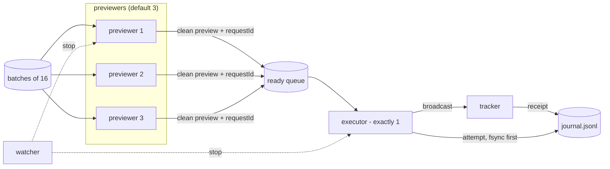

# Architecture

`pearl-miner` has three independent stages. Proofs are mined long before the day opens; the submitter only has to
turn a file of proofs into on-chain claims as fast as one wallet allows, without ever sending a proof twice or
spending more than you allowed.

```text
miner/miner.py ──proofs.csv──▶ submit/export_proofs.py ──proofs.json──▶ submit/pearl_submit.py run ──▶ chain
                                                                                                    │
                                                                       submit/pearl_sell.py ◀───────┘ (after the run)
```

## 1. The miner

`miner/miner.py` runs `keccak_miner.cl` on an OpenCL GPU. Each work item hashes
`seed ‖ (random 24-byte prefix ‖ 8-byte counter)` with a hand-unrolled Keccak-f[1600] and keeps the counter when the
first 30 bits of the digest are zero (it tests the low 32 bits of lane 0 against a mask, which is the same thing).
Every GPU hit is re-hashed on the CPU before it is appended (and fsynced) to `proofs.csv`; a mismatch aborts.

- `--test` runs the kernel with an easy mask, checks 2,000 hits on the CPU and compares the number of hits the GPU
  counted with the number expected.
- `--list-devices` / `--device N` choose among all OpenCL devices (default: the first NVIDIA GPU, else the first GPU).
  Each launch is sized to about `--launch-ms` (250 ms), so a GPU that drives a display stays clear of the Windows
  and macOS watchdogs: `miner/autotune.py` times launches with `perf_counter`, never grows the work on a launch
  measured at under 0.1 ms, and at most 8x per step. See [PLATFORMS.md](PLATFORMS.md) for the vendors and systems
  tested.
- `--bench 20` reports the hash rate. An RTX 4070 SUPER does about 2.0–2.1 GH/s, which is roughly 1.9 proofs per
  second or 6,800 per hour at stage 0.
- Create the file `STOP` next to the output to stop it cleanly.

`submit/export_proofs.py` derives the seed from your wallet, re-verifies every line of `proofs.csv`
(digest, length, stage-0 target), drops duplicates and writes `proofs.json` atomically. It uses pycryptodome when it
is installed and the submitter's pure-Python Keccak otherwise.

Every tool checks its inputs before it does anything: the wallet must be `0x` + 40 hex digits (a mixed-case address
must carry a valid EIP-55 checksum) and is lower-cased before the seed is derived; the miner refuses a `--seed` that
is not the seed of the given wallet; the handle must pass the registry's `isValidHandle` (`a-z0-9`, 3 to 20
characters, so no `.ai`, upper case or spaces). Nothing is corrected silently, because a corrected value would mine or
claim for the wrong identity.

## 2. The submitter (`pearl_submit.py`)

Standard library only, one file, so it can be copied to the machine that holds the wallet session.

| Subcommand | What it does | Sends a transaction? |
|---|---|---|
| `check` | the registry's `ownerOf(agentId)` against your wallet, `baw` session and settings, RPCs, clock against the chain, `owner()` burned, `paused()`, balance, the next day's reward floor, and, once `proofs.json` exists, a sample of proofs unused and an `eth_call` of `mineBatch` from your wallet (identity + proofs). Without a proofs file it does the rest, so you can run it before mining. | no |
| `rehearse` | previews and executes N harmless `transfer(self, 0)` calls, concurrently or `--back-to-back`, and reports what the wallet backend accepts | yes, N zero-value transfers |
| `run` | waits for the target day (default: the next opening; a negative day, or one whose `--minutes` window is over, is refused) and submits | yes |

### Threads in `run`



- **Previewers** take a batch of up to 16 proofs, build the `mineBatch` calldata and call
  `baw contract-call preview`. They start `--lead` (0.6 s) before the opening, staggered by `--stagger` (0.25 s).
  A clean preview goes to the ready queue with its `requestId`, gas limit and expiry.
- **The executor** is the only thread that ever calls `baw contract-call execute`. It waits up to `--settle`
  (3 s) for the previous transaction's receipt, because the wallet backend handles one transaction per address and
  answers anything else with `351716`. `--executors` must be 1; the program refuses anything else.
- **The tracker** polls receipts (rotating over the RPCs, so a lagging node cannot hide one), books the real fee,
  counts `Mined` events and handles reverts.
- **The watcher** reads `(miningDay, dailyRemaining, currentReward)` every 0.5 s through **one** Multicall3
  `aggregate3` call, so the three values always come from the same block, and enforces the stop rules.
- **The main thread** prints a status line every 15 s and a `SUMMARY` at the end.

### The lock and the gate

There are three locks, always taken in this order: `launch_lock → lock → Journal.lock`.

`execute` is launched by `baw(…, launch_lock, gate)`: the gate (not stopped, no diagnosis running, fee estimate
unchanged, budget not exceeded) is evaluated and the process is started **while holding `launch_lock`**. `stop()`
takes the same lock, so once a stop is recorded no further `execute` can start. Previewers classify a preview and
publish the result under the same lock, so the executor never launches between "this preview failed" and "the
failure is being diagnosed".

### Deadlines

| Deadline | Default | What happens |
|---|---|---|
| First preview | opening − `--lead` (0.6 s) | previewers start; nothing is executed before a target-day read |
| Opening grace (`LAG_GRACE`) | 30 s after our first target-day read | see below |
| Chain still on the old day | opening + 60 s | stop |
| Preview expiry | `expiresAt` − 15 s | the batch is previewed again instead of executed |
| Receipt missing | 180 s after broadcast | the tx is marked `stale`; its proofs stay blocked and its fee stays reserved |
| Backend busy (`351716`) | 180 s in a row | stop |
| Run deadline | opening + `--minutes` (90) | stop |

### The opening grace

At the opening, the wallet backend's simulator can still be a block behind and fail a preview with
`351805 execution reverted` although the day is open. The submitter never guesses:

1. It re-runs the same call with its own `eth_call` to read the revert reason. `DailyLimitReached` before the
   opening, `ProofAlreadyUsed` (drop those proofs and continue) and a cap that no longer fits the batch (split it)
   are explained outcomes. Any other revert reason stops the run.
2. If our own call **succeeds** while `baw` failed, the failure is only accepted as "backend lag" when `baw` itself
   approves the very same calldata on a re-preview inside the grace. This is sound only because the owner is burned:
   within one day a fixed batch can go from success to failure (the cap fills, proofs get used) but never back, so a
   failure followed by an approval proves the failure came from the previous day.
3. While a failure is being diagnosed the executor holds. Every blocking call in the diagnosis re-checks the
   grace; once it is over, nothing is reclassified and the run stops as "unexplained".

### Near the cap

Before each execute close to the cap, the executor reads the chain again and subtracts the proofs of its own
transactions still in flight. If the batch would not fit as a whole (and so would revert as a whole), it is split
to the room that is left and the front part is previewed again. Previewers stop drawing new batches when the
transactions already in flight cover what is left. The watcher stops the run as soon as
`dailyRemaining < currentReward`.

### Reward floor

`mineBatch` reverts with `RewardChanged` if a batch pays less than `minTotalReward`. `run` sends
`floor × batch size`, where the floor is the lowest reward possible on `--day` (the claim that fills that day's cap)
minus 1%: 90.40 on day 1, 86.24 on day 2, 82.18 on day 3. `check` prints the floor for the next day.
`--min-reward` (at least 1 coin) overrides it. From day 44 on the caps give no bound and the floor is 0; `run` and
`check` say so. See [CONTRACT.md](CONTRACT.md#reward-per-proof).

### Gas budget

```text
budget = min(--budget-bnb, fees already paid + balance at start − --keep-bnb)
committed = fees paid + fees reserved for unknown outcomes + estimates for txs in flight
```

An execute is launched only if `committed + estimate ≤ budget`, where the estimate is
`gasLimit × max(0.15 gwei, 1.5 × highest gas price seen)`. Every 3 s the watcher also checks that the live balance
minus everything in flight stays above `--keep-bnb`.

### The journal

`journal.jsonl` is append-only; every record is written with `flush` + `fsync`. The run takes an exclusive,
non-blocking lock on the file itself (`flock` on macOS and Linux; on Windows a byte lock at offset 2^40 through a
second handle, far past any data, because Windows byte locks also block reads of the bytes they cover), so a second
sender on the same journal refuses to start, whatever path it uses.

| Event | Meaning on replay |
|---|---|
| `attempt` | written and fsynced **before** every execute: its proofs are blocked from now on and its fee is reserved |
| `exec_rejected` | the backend provably did not send it (`351716`, or the gate said no): proofs released, reservation dropped |
| `exec_unknown` | any other execute outcome: proofs stay blocked, fee stays reserved |
| `broadcast` | tx hash known: tracked until a receipt arrives, also after a restart |
| `receipt` | real fee booked; a reverted receipt releases exactly that transaction's proofs |
| `used_elsewhere` | proofs the chain reports as already used: never sent again |
| `stale`, `stop`, `crash`, `run_start`, `run_end`, `baw` | bookkeeping and the raw `baw` answers |

On start, `blocked_from_journal()` replays the file in order. A proof is blocked from its first attempt until a
receipt shows that very transaction reverted. Broadcasts without a receipt are resolved against the chain or tracked
again. Restarting after a crash, a reboot or a `STOP` therefore never resends a proof that might have landed.

### Stop rules

The run stops (and no further `execute` starts) on any of:

- a preview with any risk item, `requireConfirmation` not `false`, or an incomplete answer;
- a simulation failure that cannot be explained (see the opening grace);
- `dailyRemaining < currentReward` for the target day, or the chain moving past it;
- the gas budget or the BNB keep reserve;
- three execute failures in a row, three unexplained reverts, 40 near-cap mismatches;
- `execute` returning `PENDING_CONFIRMATION` (the wallet wants approval in the Binance app);
- the `STOP` file, `SIGINT` / `SIGTERM`, or the run deadline;
- a crash in any worker thread.

## 3. The seller (`pearl_sell.py`)

Runs only after the mining run has finished: it refuses while the process in `submit/run.pid` is alive, and also when
that file is missing (start the run with `& echo $! > submit/run.pid`), because the wallet handles one transaction at
a time. It also refuses unless `--wallet` is the wallet `baw` is signed in to (`baw wallet address`, BSC entry):
balances are read for `--wallet`, but swaps leave from the signed-in wallet, so a wrong `--wallet` would make the
kept 20% meaningless. Standard library only; it imports the address check from `pearl_submit.py`, so keep the two
files together.

- `plan` is read-only: balance, the amount to sell, one reference quote.
- `run` sells `--fraction` (80%) of the balance in chunks of up to `--chunk` (100k) coins and keeps the rest.
  Every chunk gets a 1,000-coin reference quote and a chunk quote; `impact = 1 − chunk rate / reference rate`. Above
  `--max-impact` (2%) the chunk is halved down to `--min-chunk`, then it waits and quotes again.
- `--mode trail` (default) waits for a pullback of `--pullback` (7%) from the running high of the price, or for a
  linear schedule that starts after `--warmup` (20 min) and reaches 100% at `--deadline` (120 min). `--mode now`
  sells at once.
- Swaps go through `baw market-order swap --mev true` with a slippage cap. After a swap it polls the order to
  `FINISHED` / `FAILED`; an order whose state is unknown stops the script instead of being sent again.
- Progress is measured from the on-chain token balance, never from assumed fills. Restarts read `sell.jsonl` and keep
  the first session's kept amount.
- `--dry-run` uses real quotes and simulated fills; nothing is sent.

## 4. Verification harnesses

| Harness | What it proves |
|---|---|
| `submit/test_submit.py` | the submitter against a fake chain and a fake `baw`: cap filling, risk items, execute timeouts, restarts from the journal, backend lag at the opening, transient errors, gas budget, `351716`, near-cap splitting, a second sender, a disconnected session, input checks (wallet and EIP-55, handle, `--min-reward`, `--day`), `check` on day 43 without a proofs file, and more. No proof is ever sent twice. |
| `miner/test_autotune.py` | the miner's launch sizing without a GPU: a launch timed at 0 s, a negative or tiny time never grows the work, growth is at most 8x per step, and simulated devices from 2 MH/s to 10 GH/s never get a launch near the 2 s Windows watchdog. |
| `submit/test_sell.py` | the seller against a constant-liquidity pool model calibrated on the real pool: impact cap, schedule, pullbacks, partial fills, refunds, lagging balance reads, timeouts, restarts, a `--wallet` that is not the wallet `baw` is signed in to. |
| `submit/fork_rehearsal/run_fork.py` | the real contract on an anvil fork of BSC. Your wallet is impersonated (no key), a fake `baw` turns preview / execute into `eth_call` / `eth_sendTransaction` on `127.0.0.1` only (the script refuses a local port that is already in use and stops at once if anvil exits while starting), the day before the target is set full so nothing can be mined early, the next day opens live 30 s after the start and a competitor eats the cap. It then checks that every proof in a successful transaction is used on chain, that the journal replays to nothing reserved or open, that the fees in the journal equal the balance spent, and that the run stopped because the cap was full. |
| `tools/replay_log.py` | replays a run log with its original timing; `--anonymize` masks every hex value of 4+ digits after `0x`/`0X` (also cut-off ones), bare hex runs of 40+ characters, the handle in `keccak256('…')`, the local date and time, block numbers in any form, `check`'s block timestamp and e-mail addresses, replaces clock times with the time since the opening, removes block numbers and rounds BNB amounts. It hides values, not the run: the opening time is public, so the timing and the number of transactions can still be matched against the chain. `tools/test_replay_log.py` checks these rules offline. `run_fork.py --anonymize` applies the same rules live, for recordings. |
